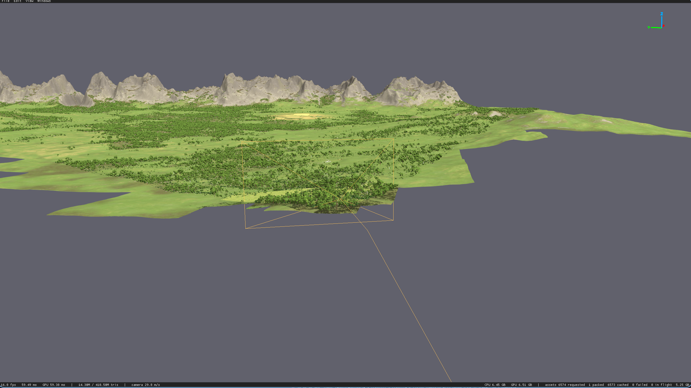
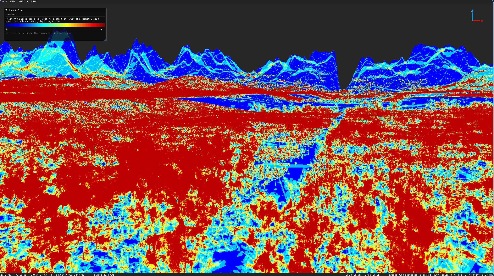
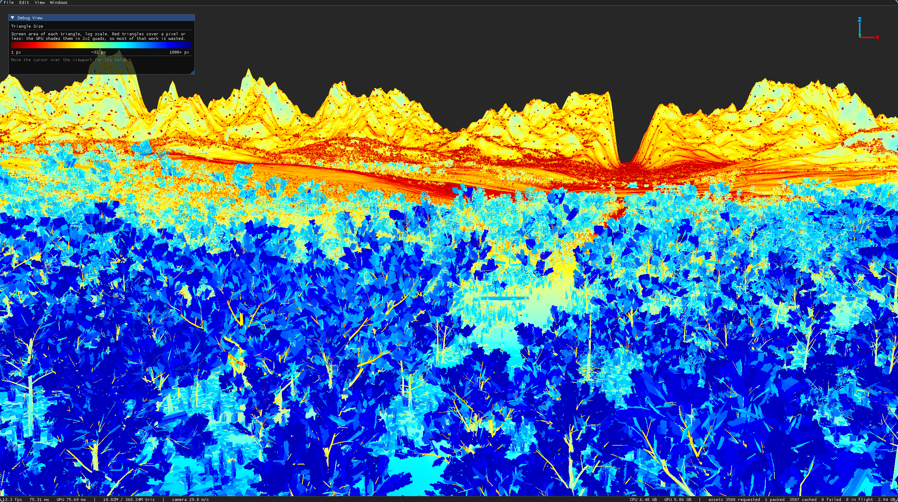
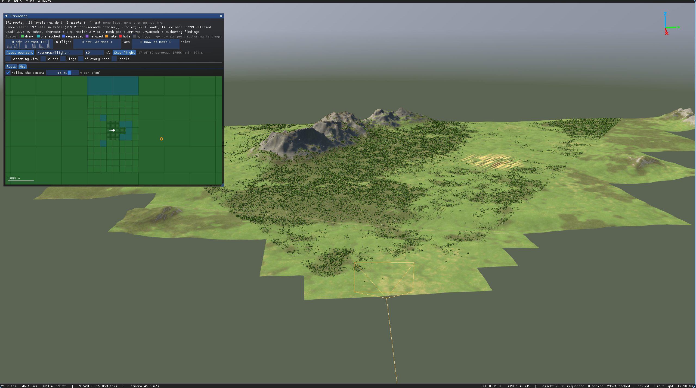
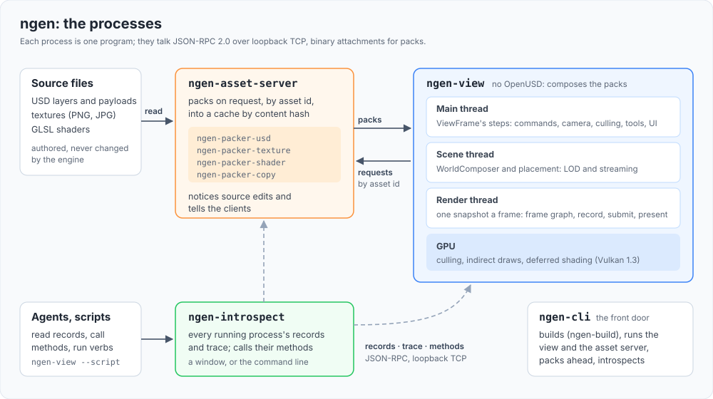
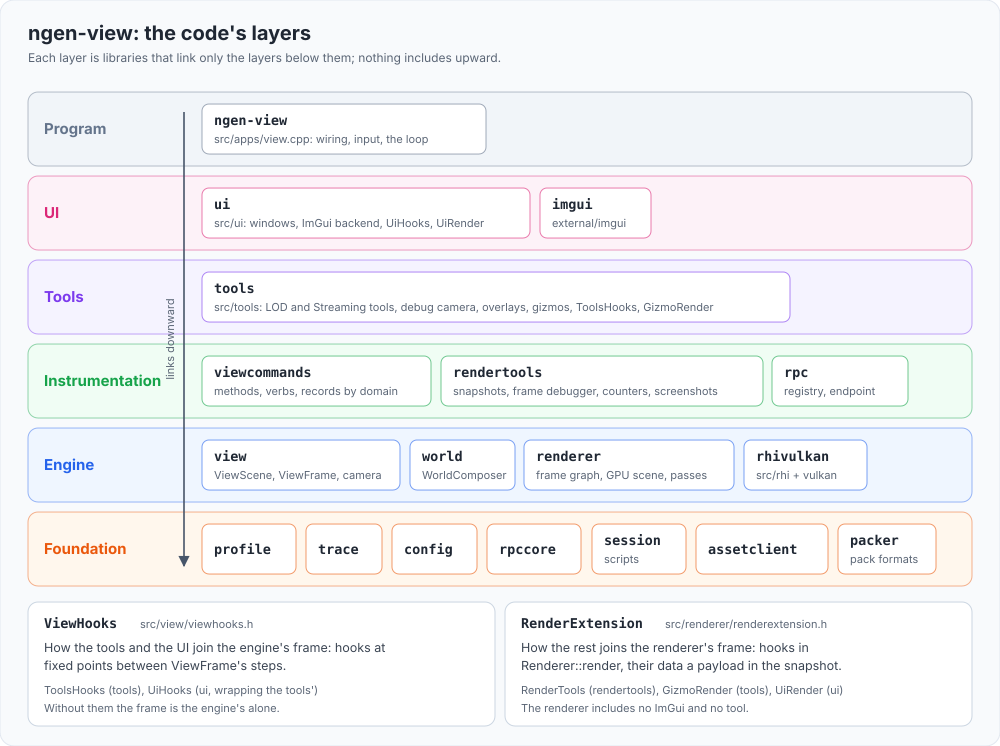

# ngen

A C++23 engine with a Vulkan 1.3 renderer that streams large OpenUSD worlds. Worlds are authored in USD; an asset server packs them into
engine-ready packs on request, and the viewer, `ngen-view`, composes those packs at runtime, streams and LODs them by the camera, and draws them
GPU-driven, without linking OpenUSD. Everything it holds and does can be read and driven at runtime, by a person through its windows and by an
agent through records, RPC methods and scripts.


*Moving through Eldermark, the streaming test world (10 km × 10 km, every cell a UsdLod root with payloaded levels): the world streams in and
out and changes level around the camera as it moves.*

## Features

**Worlds and streaming**
- **USD as authored, without OpenUSD at runtime.** `ngen-asset-server` packs each USD layer into a layer pack (`ngen-packer-usd`); the view's
  `WorldComposer` composes them as USD's Pcp does: sublayers, references, payloads, variant sets, instancing and `PointInstancer`.
- **Streaming and LOD as one system**, from UsdLod's schemas: every LOD root picks a level by its authored distance or screen-size heuristic;
  payload levels stream in and out by the camera's position and the authored load and unload radii, with no timers; inline levels are picked
  per placement on the GPU and cross-fade with a dither over their authored band.
- **Assets are streamed**, not loaded: packs, meshes, materials, textures and shaders come from the asset server over RPC, by asset id; the view
  never waits for them, and the asset server repacks what changed at its source and tells the view.

**Rendering**
- **Meshlets on mesh shaders**: meshes are split into meshlets of at most 64 vertices and 124 triangles when they are packed
  (meshoptimizer), and every pass draws them with task and mesh shaders. Culling runs per instance, then per meshlet (frustum, normal
  cone), and two-phase occlusion culls both against a depth pyramid. At a test-world viewpoint the camera draws 4.95 M triangles where
  culling whole instances drew 13.98 M, and the frame takes 15.2 ms instead of 48.8 (AMD Radeon 890M, 2560×1440).
- **GPU-driven only**: persistent GPU scene tables (instances, meshes, meshlets, materials), one geometry pool, bindless material textures,
  GPU culling with ordered compaction into meshlet work, one indirect call per bucket per view.
- **Deferred shading**: a G-buffer, cascaded shadow maps in one atlas with hardware-compare PCF, a directional sun, the scene's dome light as
  its sky and its diffuse light (spherical-harmonic irradiance from an HDR lat-long; a hemisphere ambient without one), FXAA, reversed-Z with an
  infinite far plane.
- **A frame graph** orders the passes, derives every barrier, culls unused passes and pools transient textures.
- **A render thread** fed by one snapshot a frame; a **scene thread** composes and places the world; the main thread never waits for either.
- **Vulkan 1.3** behind a thin, backend-agnostic RHI, with dynamic rendering and synchronization2.

**Seeing inside**
- **Debug views**: wireframe, triangle size, overdraw, instance, mesh, material and primitive ids, meshlets and meshlet culling, occlusion's depth pyramid, UVs,
  streaming state, LOD level, mip level, shadow cascades and the G-buffer, each with a legend and a cursor readout.
- **Tools**: the LOD and Streaming tools (every root's levels, measures, residency and findings, with viewport layers and a map), a debug camera
  that watches the main camera's frustum, culling and streaming from outside, camera modes (following the ground, orbiting), camera flights.
- **Introspection**: the frame graph with live previews, a frame debugger (barriers, commands, descriptor sets), resource captures, GPU
  counters, a GPU scene inspector, the memory of every allocation, a CPU and GPU profiler, and RenderDoc.
- **For agents**: every window's data is also a record, every action an RPC method and a script verb. `ngen-view` runs headless with a script
  (`--script`, `--screenshot`), and `ngen-introspect` lists, reads and calls any running process, and streams its trace.

**Tooling**
- **A self-hosted build system**, `ngen-build`: the project is a C++ program (`build.cpp`) against a reusable framework; no CMake, no Ninja.
- **`ngen-cli`**, the front door: build, run the view and the asset server, introspect.
- **Configuration**: every engine setting is a typed value declared by its owner, readable and settable at runtime (`config.*`).

## Screenshots

| | |
|---|---|
|  |  |
| **LOD Level view**: each draw coloured by the level it draws, finest to coarsest, across the world's nested LOD roots. | **The debug camera** watching the main camera, its frustum in orange: culling and streaming follow the main camera, so only what it draws is drawn. |
|  |  |
| **Overdraw**: fragments shaded per pixel without the depth test; the forest canopy is where the geometry pass spends its time. | **Triangle Size**: each triangle's screen area, log scale; red triangles cover a pixel or less. |
|  |  |
| **Meshlet view**: every meshlet in a colour of its own; the unit the renderer draws and culls. | **Meshlet Culling**, from a debug camera above the main camera: its meshlets coloured by the test that removes them, green drawn, red outside the frustum, blue facing away, magenta hidden by depth. |


*The Frame Graph window: the frame's passes left to right with the resources they read and write, live previews of every texture, and the
selected pass's GPU time, reads and writes.*


*The Performance window: the main, render and GPU lanes on one clock, frame by frame; here the geometry pass, split by bucket.*


*The frame budget overlay (Ctrl+B), for content developers: the GPU's passes summed by group in plain words, each group's passes beneath,
as bars against the frame budget (`profile.budget.frameMs`, 60 fps by default), with the frame's draws and triangles. Here, in the forest,
the GPU uses all of its 16.7 ms: shadows take 6.0 ms, geometry 4.9 and culling 3.8, for 306.5K draws and 9.2M triangles.*



*The Streaming window's map during a flight: every streaming root from above in its state's colour, finer tiles around the camera, the
next ones prefetched ahead of it; behind, the debug camera watches the main camera's frustum cross what is resident.*

## Architecture



`ngen-asset-server` packs the authored files on request into engine-ready packs and streams them to `ngen-view` by asset id. The view composes
them on its scene thread, steps its frame on the main thread and renders on its own thread. `ngen-introspect`, scripts and agents read every
running process's records and trace and call its methods.



Each layer is a library that links only the layers below it. The engine's frame is a fixed order of steps (`ViewFrame`); the tools and the UI
join it through hooks at fixed points (`ViewHooks`), and join the renderer's frame as render extensions (`RenderExtension`).

### Library documentation

Each library documents its design and rules in a README next to the code:

- [`src/rhi/README.md`](src/rhi/README.md) — RHI principles, the integrator contract, the example programs, known gaps.
- [`src/renderer/README.md`](src/renderer/README.md) — how a frame is built: GPU scene tables, meshlets drawn by task and mesh shaders, GPU culling per
  instance and per meshlet, occlusion culling, descriptor sets, frame graph rules, shadows, trace events.
- [`src/rendertools/README.md`](src/rendertools/README.md) — the renderer's instrumentation, a render extension: debug snapshots, the frame
  debugger, GPU counters, the texture inspector and dumps, screenshots.
- [`src/trace/README.md`](src/trace/README.md) — the trace: `TRACE_EVENT`, the always-on ring per process, streaming events over RPC, conventions.
- [`src/profile/README.md`](src/profile/README.md) — profiling: the markers, the built-in collector and GPU lane behind the Performance window, and
  Tracy as a second sink.
- [`src/config/README.md`](src/config/README.md) — configuration: the engine's settings as typed values declared in code, their names, threads,
  changes, and how they are read and set at runtime.
- [`src/rpc/README.md`](src/rpc/README.md) — how ngen processes and agents talk: JSON-RPC over loopback TCP, discovery, threading, adding a method, records.
- [`src/introspect/README.md`](src/introspect/README.md) — `ngen-introspect`: every running process's records in a window or on the command line, and calling their methods.
- [`src/build/README.md`](src/build/README.md) — the self-hosted build system: framework, IR, runner, bootstrap.
- [`src/scene/README.md`](src/scene/README.md) — the plain types the renderer and ngen-view share for what is drawn.
- [`src/editor/README.md`](src/editor/README.md) — the USD editor code, unbuilt until `ngen-editor` is built from it.
- [`src/asset/README.md`](src/asset/README.md) — the asset system: asset ids, `ngen-asset-server`, its cache and stream, `AssetClient`, and packing (`pack.cpp` rules, packers, meshlet building).
- [`src/view/README.md`](src/view/README.md) — ngen-view's scene: the World composed from packs and flattened into the renderer's inputs; its commands and dumps.
- [`src/tools/README.md`](src/tools/README.md) — the tools: the LOD and Streaming tools and the debug camera, their data and state, apart from the UI that draws them.
- [`src/world/README.md`](src/world/README.md) — the runtime scene: the World composed from scene packs as USD composes a stage, and `ngen-worldcheck` / `ngen-usdcheck` to compare the two.

[`GLOSSARY.md`](GLOSSARY.md) defines the terms these READMEs use, in a line or two each, and lists the words that mean different things in
different parts of the engine.

`docs/` holds plans and design history; code and library READMEs do not depend on it. Why the engine is shaped as it is, decision by decision,
is in [`docs/adr/`](docs/adr/README.md).

### Threads

- **Main thread**: the frame's steps in order: the scene's latest snapshot, the commands (script lines and RPC calls), the camera, culling and
  cascades, the tools and the UI, then the frame's `RenderSnapshot` for the render thread.
- **Scene thread** (`ViewScene`): composes the world from the packs as they arrive, places it (LOD levels, residency), and publishes snapshots
  and the changes for the renderer. Nothing waits for it.
- **Render thread**: takes one snapshot a frame (the main thread is at most one frame ahead), applies the scene's changes within an upload
  budget, builds and records the frame graph, submits and presents.
- **Workers** (`JobSystem`) for parallel work; the asset client receives on its own thread.

## Dependencies

| Library | Purpose |
|---------|---------|
| [SDL3](https://github.com/libsdl-org/SDL) | Window, input, Vulkan surface |
| [Vulkan SDK](https://vulkan.lunarg.com/) | GPU API + glslc shader compiler |
| [GLM](https://github.com/g-truc/glm) | Math (vectors, matrices, quaternions) |
| [stb](https://github.com/nothings/stb) | Image decoding when packing, PNG writing |
| [Dear ImGui](https://github.com/ocornut/imgui) | The windows |
| [OpenUSD](https://github.com/PixarAnimationStudios/OpenUSD) | Reading USD when packing (`ngen-packer-usd`) and in `ngen-worldcheck` / `ngen-usdcheck`; `ngen-view` doesn't link it |
| [nlohmann/json](https://github.com/nlohmann/json) | JSON for RPC, records and packs |
| [tinyexr](https://github.com/syoyo/tinyexr) | Reading OpenEXR in `ngen-packer-exr` (a dome light's HDR sky) |
| [meshoptimizer](https://github.com/zeux/meshoptimizer) | Welding and meshlets for the USD packer's meshes |

GLM, stb, Dear ImGui, OpenUSD, nlohmann/json, tinyexr and meshoptimizer are git submodules in `external/`. SDL3 and the Vulkan SDK must be installed on the system.

After cloning, initialize the submodules:

```bash
git submodule update --init --recursive
```

## Building OpenUSD

OpenUSD must be built separately before building the engine. This only needs to be done once. Requires CMake and Python 3.

```bash
python3 external/openusd/build_scripts/build_usd.py \
  --no-python --no-imaging --no-tests --no-examples \
  --no-tutorials --no-tools --no-docs --no-materialx \
  --no-alembic --no-draco --no-openimageio --no-opencolorio \
  --no-openvdb --no-ptex --no-embree --no-prman \
  --onetbb --build-variant release \
  -j$(nproc) \
  external/openusd_build
```

## Building

The engine is built by its own self-hosted build system (`ngen-build`). Requires `clang++` with C++23 support, the Vulkan SDK and `glslc`. OpenUSD
must be built first (see above).

Bootstrap `ngen-build` once (and again whenever `src/build/bootstrap.cpp` or the IR format in `src/build/ir/schema.hpp` changes), then build:

```bash
mkdir -p _out && c++ -std=c++23 -O0 -g -pthread -o _out/ngen-build src/build/bootstrap.cpp
./_out/ngen-build -p linux-vulkan -c debug      # no target: every program, examples included (not format / tidy)
```

`ngen-build` takes the platform (`-p`) and config (`-c`) on every call; configs are `debug`, `release` and `gamerelease`. Binaries land in
`_out/<platform>/<config>/`, so the viewer is `_out/linux-vulkan/debug/ngen-view`. Shaders are packed assets: the view requests them from
`ngen-asset-server`, which runs `ngen-packer-shader` (GLSL to SPIR-V with `glslc`) and streams the result. Start the server before the view, and
leave it running, in the same directory as the view: `./ngen-cli asset-server &`, or `./_out/linux-vulkan/debug/ngen-asset-server &`
(`src/asset/README.md`). Its working directory is the root asset ids are relative to. Without it the view exits at start-up.
`./_out/ngen-build -h` lists every flag (`--clean`, `--rebuild`, `--list`, `--compile-commands`, …); `format` and `tidy` are targets. For day-to-day
use, `ngen-cli` (next section) remembers the platform and config for you.

See [src/build/README.md](src/build/README.md) for the build system internals (framework layout, extension model, IR and runner, adding platforms
and configurations).

## ngen-cli

`ngen-cli` is the front door to the engine's tools. You pick a platform and config once with `set`; after that, `build` and the tool commands use
it, so you stop spelling out `-p`/`-c` and `_out/<platform>/<config>/` on every command.

[`REFERENCE.md`](REFERENCE.md) is the quick reference for every tool's commands and flags, ngen-view's keys and script verbs, the RPC methods,
the records and the configuration values.

### First-time setup

With `ngen-build` bootstrapped (see Building), build the cli for one variant and set it:

```bash
./_out/ngen-build -p linux-vulkan -c debug ngen-cli
./_out/linux-vulkan/debug/ngen-cli set linux-vulkan debug
```

`set` creates `./ngen-cli` in the repository root, a symlink to the set variant's cli. From then on use `./ngen-cli` (or put the repository root
on your `PATH`). It works from any directory: `../ngen-cli` from `src/` behaves the same.

### Commands

| Command | What it does |
|---|---|
| `ngen-cli set <platform> <config>` | Make a variant the set one. Names are checked against `ngen-build --list`; a unique prefix is enough (`set linux release`). Builds that variant's cli first, then moves the `./ngen-cli` link to it. |
| `ngen-cli set` | Print the set variant. |
| `ngen-cli build [args]` | Run `ngen-build` for the set variant. `-p`/`-c` are filled in only when you don't pass them, so `build -c release` builds the set platform in release, and `build -p … -c …` works like plain `ngen-build`. Every other argument passes through: targets, `-v`, `--clean`, `format`, `tidy`, … |
| `ngen-cli view [args]` | Run the set variant's `ngen-view` with your arguments, in your working directory. |
| `ngen-cli introspect [args]` | Run the set variant's `ngen-introspect`: with no arguments its window; `list` running tools and their records, `get` a record, `describe` a tool, `call` its methods (`src/introspect/README.md`). |
| `ngen-cli asset-server` | Run the set variant's `ngen-asset-server` in the foreground, until Ctrl-C. `view` needs it running (`src/asset/README.md`). |
| `ngen-cli pack <scene>...` | Run the set variant's `ngen-pack`: the asset server packs everything the scenes can reach (every LOD level and variant), so a view opens them from a full cache (`src/asset/README.md`). |
| `ngen-cli help` | The commands, the set variant, and which tools are built for it. |

Forwarded tools replace the cli process, so their output, signals and exit code are exactly those of running the tool directly.

### Examples

```bash
./ngen-cli build                             # build ngen-view for the set variant
./ngen-cli asset-server &                    # start its asset server, and leave it running
./ngen-cli view assets/three_cubes.usda      # run it
./ngen-cli build examples                    # the RHI example programs
./ngen-cli build -c release ngen-view        # one-off release build; the set variant stays as it is
./ngen-cli set linux release                 # switch the set variant to release
./ngen-cli build format                      # clang-format the tree
```

### Things to know

- **The set variant is stored in `_out/set`**, one line such as `linux-vulkan/debug`. Tools of that variant are `_out/<that line>/<tool>`, which
  scripts can use too: `_out/$(cat _out/set)/ngen-view`.
- **`view` does not build.** On a variant you haven't built yet, it says `ngen-view is not built` and names the command: `ngen-cli build`.
- **A build without a target builds everything.** `./ngen-cli build` builds every program of the variant, the cli and the examples included;
  name a target to build less (`./ngen-cli build ngen-view`). `format` and `tidy` run only when named.
- **Cleaning the set variant removes its cli too.** `./ngen-cli build --clean` is `ngen-build --clean`, and the cli lives in the variant's output
  directory, so `./ngen-cli` dangles afterwards. Recover with `./_out/ngen-build -p <platform> -c <config> ngen-cli`, or run the first-time setup
  again. To forget the set variant, delete `_out/set` and `./ngen-cli`.

## Usage

`ngen-view` needs its variant's asset server running in the same directory; scenes are asset ids, paths relative to that directory.

```bash
./ngen-cli asset-server &                                        # once, and leave it running
./ngen-cli view assets/three_cubes.usda
./ngen-cli view assets/streamtest-world/world/root.usda --camera=/cameras/village
```

| Flag | What it does |
|---|---|
| `--camera=<pose or /path>` | Start at a pose (`x,y,z,yaw,pitch`) or a camera the scene authors |
| `--view=<lit, albedo, normals, …>` | The G-buffer or debug view to show |
| `--overlay=<name=on/off,…>` | Overlays: grid, origin, gizmo, aabbs, lightgizmos, cascadefrusta, buffer, shadow, aa |
| `--script=<file>` | Script lines: `<frame> <verb> <args>`, frames counted once the scene is resident |
| `--screenshot=<file>`, `--frames=<n>` | A PNG of the last frame, and quit after `n` frames |
| `--validation`, `--fail-on-validation` | Vulkan validation; with the second, exit nonzero on any validation error |
| `--show-ui` | Keep the UI in screenshots |
| `--no-wait-resident` | Count script frames from start-up instead of from the scene being resident |
| `--renderdoc`, `--no-rpc`, `--render-debug`, `--geometry-limit=<MiB>`, `--select=<path>`, `--camera-frame=<path>` | RenderDoc capture, no endpoint, the render debug snapshot always on, the geometry pool's limit, a selection, framing a prim |

`SDL_VIDEODRIVER=offscreen` runs it without a window. The verbs, records and methods are listed by `./ngen-cli introspect describe` against a
running view; `src/view/README.md` has them by domain.

### Controls

| Input | Action |
|---|---|
| WASD, Q / E, Shift | Move; down / up; five times as fast |
| Right mouse button | Hold to look around |
| Mouse wheel | Fly speed (×1.25 a notch); toward the pivot while orbiting |
| Left Alt | Hold to orbit around the surface under the cursor |
| G | Follow the ground at eye height |
| Left click | Pick a prim, or grab the active gizmo's handle; on the corner axis gizmo, look along that axis |
| Z, R, F | Deselect, select the parent, frame the selection |
| Ctrl+D, C | Debug camera on or off; hand the controls between it and the main camera |
| 1 – 5 | Wireframe, triangle size, overdraw, instance and streaming views (again for off) |
| Ctrl+1, Ctrl+2 | The G-buffer and shadow overlays |
| Ctrl+3, Ctrl+4, Ctrl+5 | The mip level and LOD level views; back to the plain lit image |
| Ctrl+P, Ctrl+C, Ctrl+S, Ctrl+L, Ctrl+A | The Performance, Camera, Streaming, LOD and Assets windows |
| Ctrl+B | The frame budget overlay: the GPU's passes by group against the frame budget |
| F12 | Screenshot |

Every window is under **Windows**; the overlays, purposes and camera modes under **View**.

### Test scenes

| Scene | Where |
|---|---|
| `assets/three_cubes.usda` | In the repository: three cubes on a fourth flattened into the ground; it authors no light, so the engine adds its default sun |
| Intel's New Sponza | Not in the repository: `assets/main_sponza/NewSponza_Main_USD_Zup_003.usda` |
| Eldermark | Not in the repository: a generated 10 km × 10 km world (about 24 GB), every cell a UsdLod root with payloaded levels, eleven authored cameras and a flight path, made by [world-generator](https://github.com/hschlichter/world-generator); `assets/streamtest-world/world/root.usda` |
