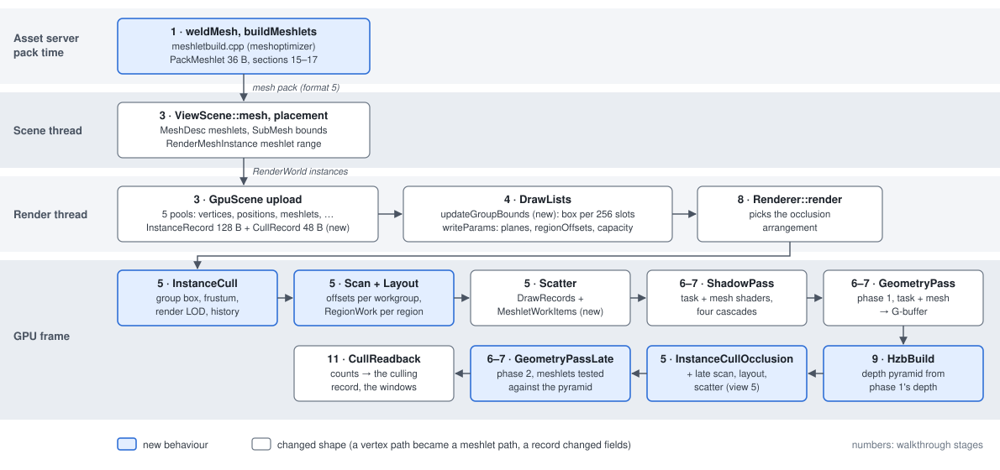
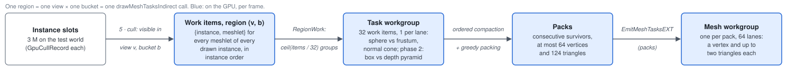
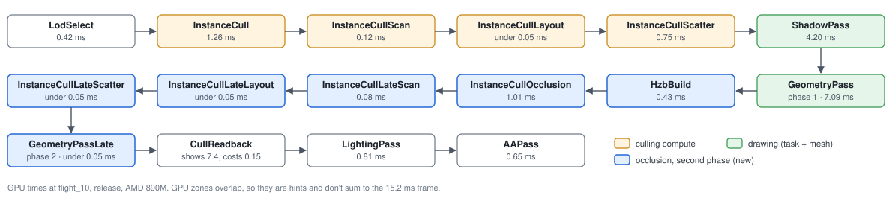
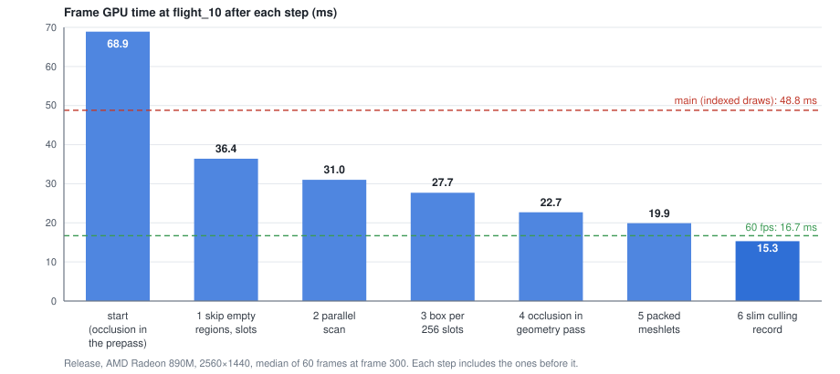

# Review: meshlets, two-phase occlusion and the performance pass

Every mesh pass now draws meshlets with task and mesh shaders, culled per meshlet (frustum, normal cone and, for the camera, a depth pyramid),
after a GPU instance cull that was rebuilt to be cheap. On the streaming test world at `flight_10`, the frame takes **15.2 ms on the GPU against
main's 48.8 ms**, and draws **4.95 M triangles against 13.98 M**.

| | |
|---|---|
| Branch | `meshlets`: `40bb2b3` "Meshlets", `a06d73b` "Meshlet performance…" and `bf647aa` "meshoptimizer" (the submodule at v1.3), on `main` at `8708fac` |
| Size | 121 files, 6,129 lines added, 1,423 removed (`git diff --stat main..HEAD`) |
| Uncommitted | this review, its screenshots, its line in `docs/reviews/README.md`, and two corrected triangle counts in the learnings and performance docs |
| Plans | [plan_meshlets.md](../plan_meshlets.md) (Landed), [plan_meshlet_culling_visibility.md](../plan_meshlet_culling_visibility.md) (Landed), [plan_subset_bounds.md](../plan_subset_bounds.md) (Landed), [plan_occlusion_culling.md](../plan_occlusion_culling.md) (Landed; decisions 1 and 7 changed, recorded there), [plan_meshlet_performance.md](../plan_meshlet_performance.md) (Landed) |
| ADR | [ADR 64](../adr/0064_meshlets_on_mesh_shaders.md), "Meshlets on `VK_EXT_mesh_shader` with occlusion culling": "Accepted", with what the code goes beyond it under Verification |
| Learnings | [meshlets_learnings.md](../meshlets_learnings.md): the guide for reimplementing it, with every measurement |
| Date | 2026-11-07 |
| Audience | A Technical Director: decides on architecture, cost and risk; knows rendering; has not followed the work |

All numbers below are from release builds on an AMD Radeon 890M (RADV, an integrated GPU sharing system memory), at 2560×1440. Frame times are
the median GPU frame time of 60 frames at frame 300 from the `profile` record, unless a row says otherwise.

## Contents

1. [Summary](#summary)
2. [What it looks like](#what-it-looks-like)
3. [The flow](#the-flow)
4. [Walkthrough](#walkthrough): [1 Packing](#1-packing-weld-then-meshlets) · [2 RHI](#2-the-rhi-mesh-shading-and-what-it-requires) ·
   [3 GPU scene](#3-the-gpu-scene-pools-mesh-table-and-two-instance-records) · [4 CPU side of culling](#4-the-cpu-side-of-culling-drawlists) ·
   [5 Culling compute](#5-the-culling-compute-instancecullcomp) · [6 Task shader](#6-the-task-shader-meshlet-culling-compaction-packing) ·
   [7 Mesh shaders](#7-the-mesh-shaders-packs) · [8 The frame](#8-the-frame-passes-phases-and-the-three-occlusion-arrangements) ·
   [9 Depth pyramid](#9-the-depth-pyramid-and-the-occlusion-test) · [10 Debug camera](#10-the-culling-camera-debug-camera-and-frozen-frustum) ·
   [11 Tools](#11-records-debug-views-and-windows)
5. [Evidence](#evidence)
6. [Decisions](#decisions)
7. [Risks](#risks)
8. [Runtime access](#runtime-access)
9. [Before merging](#before-merging)
10. [Decisions for the reviewer](#decisions-for-the-reviewer)

## Summary

| Measure | main | this branch | What it measures |
|---|---|---|---|
| Frame GPU time, `flight_10` | 48.8 ms | **15.2 ms** | A wide view over forest and meadow: 3 M instance slots in the world, 240 k drawn. A 60 fps frame has 16.7 ms. |
| Triangles drawn by the camera, `flight_10` | 13.98 M | **4.95 M** | After every cull. Main draws whole instances; the branch drops meshlets outside the view, facing away or behind others. |
| Culling compute per frame, `flight_10` | 24.8 ms | **3.2 ms** | Every compute pass that decides what draws (instance cull, scans, scatters, occlusion), plus 0.4 ms to build the depth pyramid. |
| Geometry pass, `flight_10` | 21.6 ms | **7.1 ms** | Writing the G-buffer. The shadow pass is about the same on both (5.0 ms on main, 4.2 ms here). |
| GPU geometry memory, Sponza | 674 MB | **140 MB** | Welding identical vertices (the packer emitted three per triangle) and dropping the index pool. |

**Is it correct?**
- Lit images and shadow maps were byte-identical at every step of the performance work, from the step that moved occlusion into the geometry
  pass on.
- With occlusion on and off, Sponza's lit image is byte-identical. At `flight_10` one pixel of 3.7 million differs, by 6 levels of 255: two
  surfaces at equal depth resolve in a different draw order.
- Validation was clean in 12 runs covering the test world, Sponza, the layered scene, the debug views, the debug camera, the prepass and a frozen
  frustum.
- All 17 RHI examples pass on the same lavapipe CI uses. Only the meshshader and mipchain hashes changed, and they were regenerated.

**Is it contained?** No. Mesh shading replaces the vertex path in every mesh pass:
- The index buffer, the vertex input and seven vertex and geometry shaders are gone.
- The pack format, the GPU scene and the culling passes all change shape.
- The device must now have mesh shaders, subgroup arithmetic in compute and the demote-to-helper feature. There is no fallback.

ADR 64 accepted that narrowing for mesh shaders; the subgroup and Vulkan 1.3 shader requirements are recorded in its Verification section
as going beyond the decision, not in an ADR of their own.

**Open questions:**
- **Device floor:** whether it's acceptable as it stands.
- **Subgroup arithmetic:** whether ADR 64's Verification section is enough, or it wants an ADR of its own.
- **Memory:** about 650 MB of new culling buffers on the test world.
- **One GPU only:** every number comes from a single integrated AMD GPU.

## What it looks like

The test world at `flight_10`, lit and with each meshlet in a colour of its own (`debugview meshlet`). Grass and foliage are tiny meshes, one
meshlet of about 20 triangles each; the terrain and rocks are large meshes in meshlets of up to 124 triangles.

| Lit | Meshlets |
|---|---|
|  |  |

Sponza's atrium (`--camera=-10,0,2,0,10`), where meshes are large and meshlets close to full: 41,012 meshlets for 3.75 M triangles in the
scene, 91 triangles a meshlet on average.

| Lit | Meshlets | Wireframe (`debugview wireframe`) |
|---|---|---|
|  |  |  |

What the main camera's culling keeps, seen from a debug camera 1,350 m above it. The main camera stands at the yellow frustum's tip, looking
up the image. The left image is lit: only what the main camera's culling kept is drawn. The right image is `debugview meshletcull`, which
colours every meshlet of the instances that survived instance culling by the test that would drop it:
- **Green:** drawn.
- **Red:** outside the main camera's frustum.
- **Blue:** facing away (normal cone).
- **Magenta:** behind other geometry (depth pyramid).

The terrain tiles that straddle the frustum's edge show why culling per meshlet pays: their instances pass, but most of their meshlets don't.

| Lit, from the debug camera | Meshlets by culling test |
|---|---|
|  |  |

## The flow

Numbers match the walkthrough's stages. **Bold** boxes are new behaviour; the others changed shape (a vertex path became a meshlet path, a
record changed fields).



How one region's draw turns into mesh workgroups. A region is a view × a pipeline bucket; there are 6 views (the camera, four shadow cascades,
the camera's second phase) × 4 buckets (single- or double-sided, opaque or cutout) = 24 regions, and each is **one**
`drawMeshTasksIndirect` call.



## Walkthrough

### 1. Packing: weld, then meshlets

**Files:** `src/asset/pack/meshletbuild.{h,cpp}` (new), `src/asset/pack/usd/usdpacker.cpp`, `src/asset/pack/scenepacktypes.h`,
`src/asset/pack/scenepack.cpp`, `src/apps/packdump.cpp`, `pack.cpp`, `build.cpp`, `.gitmodules`, `external/meshoptimizer` (new submodule),
`src/asset/README.md`.

**Before:**
- The USD packer wrote three fresh vertices per triangle and an index list.
- The GPU drew indexed.

**Now:** the packer welds bitwise-identical vertices, then builds meshlets per submesh with meshoptimizer: at most 64 vertices and 124
triangles each, with a bounding sphere and a normal cone. A meshlet never mixes materials. The index list stays in the pack because the CPU uses
it: subset bounds, picking, ground following.

**In and out:**
- In: `MeshPack` (vertices, indices, submeshes).
- Out: `MeshPack` with `meshlets`, `meshletVertices` (mesh-local indices) and `meshletTriangles` (one 32-bit word per triangle: three 8-bit
  corner indices), plus each submesh's meshlet range.

```cpp
// src/asset/pack/meshletbuild.cpp (abridged: the per-meshlet copy is shortened to a comment)
auto weldMesh(MeshPack& mesh) -> void {
    if (mesh.vertices.empty() || mesh.indices.empty()) {
        return;
    }
    std::vector<uint32_t> remap(mesh.vertices.size());
    auto uniqueCount = meshopt_generateVertexRemap(remap.data(), mesh.indices.data(), mesh.indices.size(), mesh.vertices.data(), mesh.vertices.size(), sizeof(PackVertex));
    std::vector<PackVertex> welded(uniqueCount);
    meshopt_remapVertexBuffer(welded.data(), mesh.vertices.data(), mesh.vertices.size(), sizeof(PackVertex), remap.data());
    meshopt_remapIndexBuffer(mesh.indices.data(), mesh.indices.data(), mesh.indices.size(), remap.data());
    mesh.vertices = std::move(welded);
}

auto buildMeshlets(MeshPack& mesh) -> void {
    …
    // meshopt_buildMeshlets's cone weight: how much it favours meshlets whose triangles face alike, so the normal cone culls more.
    constexpr float coneWeight = 0.25f;

    for (auto& submesh : mesh.submeshes) {
        submesh.meshletOffset = (uint32_t) mesh.meshlets.size();
        submesh.meshletCount = 0;
        if (submesh.indexCount < 3) {
            continue;
        }
        std::span<uint32_t> indices(mesh.indices.data() + submesh.indexOffset, submesh.indexCount);
        meshopt_optimizeVertexCache(indices.data(), indices.data(), indices.size(), mesh.vertices.size());
        …
        auto count = meshopt_buildMeshlets(
            built.data(), vertices.data(), triangles.data(), indices.data(), indices.size(), positions, mesh.vertices.size(), sizeof(PackVertex), meshletMaxVertices, meshletMaxTriangles, coneWeight);

        for (size_t i = 0; i < count; i++) {
            // meshopt_optimizeMeshlet, meshopt_computeMeshletBounds, then append to meshlets / meshletVertices / meshletTriangles,
            // each triangle as corner[0] | corner[1] << 8 | corner[2] << 16
        }
        submesh.meshletCount = (uint32_t) mesh.meshlets.size() - submesh.meshletOffset;
    }
}
```

The pack format, before and after:

| | main | branch |
|---|---|---|
| Format version | 4 | 5 |
| `PackSubmesh` | 12 bytes: index offset, count, material | 20 bytes: + `meshletOffset`, `meshletCount` |
| `PackMeshlet` | – | 36 bytes: vertex and triangle offsets and counts, sphere centre and radius, cone as four signed bytes |
| Sections | – | `MeshMeshlets = 15`, `MeshMeshletVertices = 16`, `MeshMeshletTriangles = 17` |
| `usd` rule version in `pack.cpp` | 10 | 11 (caches repack) |
| `shader` rule version | 1 | 3 (`.task` and `.mesh` added, then every shader compiled for Vulkan 1.3) |

Measured:
- Sponza's vertices go from 11.24 M to 2.03 M, and its GPU geometry from 674 MB to 140 MB.
- `arch_stones_01` goes from 189,159 vertices to 33,465, in 703 meshlets.
- Packing Sponza twice gives byte-identical packs.

**Check here:**
- **Welding compares the whole 44-byte vertex**, so hard edges keep their split normals; only exact duplicates merge.
- **`meshopt_optimizeVertexCache` reorders each submesh's indices in place.** The CPU's index list changes order but not content: harmless
  for picking and bounds, but anything that assumed authored triangle order would see a different one.
- **The reader validates everything a shader will trust** (`scenepack.cpp:596` on), so a broken pack never reaches the GPU:
  - submesh ranges inside the meshlets;
  - counts at most 64 and 124;
  - every range inside its array;
  - every local index below its meshlet's vertex count;
  - every meshlet vertex below the mesh's vertex count.
- **One word per triangle** is 33% larger than packed bytes; it's one read in the mesh shader. Compressing it was deferred.
- **The meshoptimizer submodule** is pinned at the v1.3 tag (`9e1f07b`, commit `bf647aa`). The first commit recorded a pin 53 commits past
  v1.3 (`f0a684f`), but the checkout was v1.3 throughout, so every build, pack and measurement here used v1.3.

### 2. The RHI: mesh shading and what it requires

**Files:** `src/rhi/rhitypes.h`, `src/rhi/rhicommandbuffer.h`, `src/rhi/vulkan/rhidevicevulkan.{h,cpp}`,
`src/rhi/vulkan/rhicommandbuffervulkan.{h,cpp}`, `src/rhi/vulkan/rhiresourcesvulkan.h`, `src/rhi/examples/meshshader.cpp` (new),
`src/rhi/examples/mipchain.cpp` (new), `src/rhi/examples/common/{shadercompile,upload}.h`, `src/rhi/examples/screenshots.sha256`,
`src/apps/packershader.cpp`, `src/rhi/README.md`.

**What it adds:**
- **Shader stages:** `RhiShaderStage::Task` and `Mesh`.
- **Pipelines:** `RhiGraphicsPipelineDesc::taskShader` and `meshShader`. A mesh pipeline has no vertex input and no input assembly.
- **Draws:** `drawMeshTasksIndirect` and `drawMeshTasksIndirectCount` (the renderer uses only the first; the meshshader example uses both).
- **Limits:** mesh output vertices and primitives, and the task payload size.
- **Buffer state `IndirectStorageRead`:** a buffer read as draw arguments and by shaders at once. The frame graph used to map that combined
  access to a storage read and drop the indirect stage.
- **Textures:** `R32_SFLOAT` and per-mip storage views (`RhiDescriptorWrite::mipLevel`), for the depth pyramid.
- **Pipeline statistics:** only fragment and compute invocations. A query counting input assembly, vertex or clipping may not be active while
  a mesh shader draws, and RADV has no mesh-shader statistics.

**What the device must have** (`rhidevicevulkan.cpp`; each missing one fails `init` with a message naming it):

| Requirement | Why | In the Vulkan 1.3 baseline? |
|---|---|---|
| `VK_EXT_mesh_shader`, `taskShader`, `meshShader` | every mesh pass | No; approved by ADR 64 |
| `maintenance4` | SPIR-V 1.6 declares workgroup sizes as `LocalSizeId` (only validation found it) | Yes, but must be enabled |
| `shaderDemoteToHelperInvocation` | `discard` in a SPIR-V 1.6 fragment shader demotes | Yes, but must be enabled |
| `shaderDrawParameters` | `gl_DrawID` in a task shader (the meshshader example) | 1.1 feature |
| `shaderSampledImageArrayNonUniformIndexing` | one draw spans many materials, so the texture index varies within it | 1.2 feature |
| Subgroup basic + arithmetic in compute | the culling scan's prefix sums | **No, and not in ADR 64**: a device property, not a feature |

**Every shader is now compiled for Vulkan 1.3** (SPIR-V 1.6), not only `.task` and `.mesh`; the scan's subgroup operations need SPIR-V 1.3 or
later:

```cpp
// src/apps/packershader.cpp:38
std::vector<std::string> glslc = {"glslc", args->source, "-o", args->out, "--target-env=vulkan1.3"};
```

**Check here:**
- **Device floor.** RADV, ANV, NVK and lavapipe have all of the above. Proprietary NVIDIA from Turing, AMD from RDNA2 and Intel Arc have mesh
  shaders. Older GPUs and MoltenVK don't, and nothing draws there.
- **Examples.** `ngen-example-meshshader`: a task shader culls half a grid of quads by a plane; the mesh shader draws the rest.
  `ngen-example-mipchain`: writes and reads every mip level. Both pass `--check --validation` on RADV and on CI's lavapipe.

### 3. The GPU scene: pools, mesh table and two instance records

**Files:** `src/scene/mesh.h`, `src/view/viewscene.{h,cpp}`, `src/view/placement.cpp`, `src/renderer/renderworld.h`,
`src/renderer/gpuscene.{h,cpp}`, `src/renderer/gpuschema.{h,cpp}`, `src/renderer/scenegpustats.h`, `src/view/scenecommands.cpp`.

**Before:**
- Geometry lived in three pools: interleaved vertices, positions and indices.
- Each instance record carried an index range.
- Every instance of a prim carried its whole mesh's bounds.

**Now:**
- **Five pools:** vertices, positions, meshlets (`GpuMeshlet`, 32 bytes), meshlet vertices and meshlet triangles. The index pool is gone.
- **Mesh table:** `{vertexOffset, meshletOffset, meshletCount, triangleCount}`. A mesh not in the pool has `meshletCount == 0` and never draws.
- **Instance record:** 128 bytes as before, with the index range replaced by the submesh's meshlet range.
- **Culling record:** a 48-byte `GpuCullRecord` per slot, written after the draw records in the same buffer.
- **Subset bounds:** each submesh has its own bounds (`SubMesh::bounds`), and every view draws per submesh. Before, cascades drew a prim's
  first instance with the whole mesh.

The instance record, before and after (128 bytes both):

| Bytes | main | branch |
|---|---|---|
| 0–63 | `model` | `model` |
| 64–71 | `material`, `mesh` | `material`, `mesh` |
| 72–79 | `indexOffset`, `indexCount` | **`meshletOffset`, `meshletCount`** (the submesh's, from the mesh's first) |
| 80–95 | `boundsMin`, `flags` | `boundsMin`, `flags` (bits 0 and 4 freed: `primFirst`, `primHasCutout` gone) |
| 96–111 | `boundsMax`, `lodLevel` | `boundsMax`, `lodLevel` |
| 112–127 | `lodGroup`, `streamRoot`, `lodDepth`, `pad` | `lodGroup`, **`triangleCount`**, `streamRoot`, `lodDepth` |

The culling record, new (`src/renderer/gpuscene.h:75`):

```cpp
struct GpuCullRecord {
    glm::vec3 boundsMin = glm::vec3(0.0f);
    uint32_t flags = 0;
    glm::vec3 boundsMax = glm::vec3(0.0f);
    uint32_t lod = 0;          // lodLevel in bits 0-7, lodGroup in bits 8-31
    uint32_t mesh = 0;
    uint32_t meshletOffset = 0;
    uint32_t meshletCount = 0;
    uint32_t triangleCount = 0;
};
static_assert(sizeof(GpuCullRecord) == 48);
```

Why two records: culling visits every one of the 3 M slots several times a frame, and the GPU fetches whole cache lines. Reading "only the fields
it needs" from a 128-byte record still costs the whole record. The task and mesh shaders, which touch only drawn instances, keep reading the
128-byte record for the model matrix. This step alone took 4 to 7 ms off the frame (see Evidence).

**Check here:**
- **The instance record now exists in four places that must agree:**
  - `GpuInstanceRecord` and `GpuCullRecord` in C++;
  - `Instance` in `meshlet.glsl` and `gbuffercutout.frag`;
  - `CullRecord` in `instancecull.comp`;
  - the capture schema in `gpuschema.cpp`.

  Nothing checks them against each other at build time.
- **`lod` packs the level into 8 bits and the group into 24.** That allows 255 levels and 16.7 M render-LOD groups (16,262 on the test
  world); an overflow would be silent.
- **The instance buffer grows by 48 bytes a slot:** `gpuscene.instances` is 549 MB on the test world, about 140 MB of that the culling
  records.
- **Upload writes both records per changed slot** (`gpuscene.cpp:1001`). A slot written to one and not the other would cull with stale bounds.

### 4. The CPU side of culling: `DrawLists`

**Files:** `src/renderer/drawlists.{h,cpp}`, `src/renderer/renderer.cpp:413`.

**Before:**
- 5 views × 4 buckets = 20 regions.
- Indexed indirect commands per drawn instance.
- No work items, no group boxes, no history.

**Now:**

| Holds | Size on the test world | Per |
|---|---|---|
| 24 regions (view 5 is the camera's second phase); `regionOffsets` packed one after another, each as large as the CPU counted for its bucket | – | – |
| `cull.commands`: a `DrawRecord {instance, meshletCount, firstItem, pad}` (16 B) per drawn instance per region, for the tools | 300 MB | frame slot (×5) |
| **`cull.workitems`**: `MeshletWorkItem {instance, meshlet}` (8 B), sized to twice the live meshlets, grown on overflow | 101 MB | frame slot (×5) |
| **`cull.groupbounds`**: a `GroupBox` (32 B) per 256 slots, CPU-written, mapped | 0.4 MB | frame slot (×5) |
| **`cull.history`**: a word per slot, "visible to the camera last frame" | 12.5 MB | one, kept across frames |
| `RegionWork` per region: the region's indirect mesh-task command and its work-item range | 768 B | frame slot |

Main's command buffer was the same size: 20-byte indexed commands × 5 views there, 16-byte records × 6 views here.

The group box is kept up to date only for groups whose slots changed:

```cpp
// src/renderer/drawlists.cpp:69 (abridged: the dirty marking for resized slot counts is left out)
auto DrawLists::updateGroupBounds(std::span<const GpuInstance> instances, std::span<const uint32_t> changedSlots) -> void {
    …
    for (auto slot : changedSlots) {
        if (slot < instances.size()) {
            dirty[slot / groupSize] = 1;
        }
    }
    groupSlotCount = instances.size();
    for (uint32_t g = 0; g < groups; g++) {
        if (dirty[g] == 0) {
            continue;
        }
        AABB box = {.min = glm::vec3(1e30f), .max = glm::vec3(-1e30f)};
        bool unbounded = false;
        bool live = false;
        auto end = std::min<size_t>(((size_t) g + 1) * groupSize, instances.size());
        for (size_t m = (size_t) g * groupSize; m < end; m++) {
            const auto& instance = instances[m];
            if (!instance.alive) {
                continue;
            }
            live = true;
            if (!instance.worldBounds.valid()) {
                unbounded = true;
                continue;
            }
            box.min = glm::min(box.min, instance.worldBounds.min);
            box.max = glm::max(box.max, instance.worldBounds.max);
        }
        float kind = groupBoxTested;
        if (!live) {
            kind = groupBoxEmpty;
        } else if (unbounded || !box.valid()) {
            kind = groupBoxUnbounded;
        }
        groupBoxes[g] = {
            .min = glm::vec4(box.valid() ? box.min : glm::vec3(0.0f), kind),
            .max = glm::vec4(box.valid() ? box.max : glm::vec3(0.0f), 0.0f),
        };
    }
}
```

**Check here:**
- **The CPU's bucket count must match the shader's bucket rule**, or records spill into the next region. The shader counts any spill
  (`counterRegionOverflow`) instead of writing it, and that counter must stay 0. Main's LOD fades put fading instances in the cutout buckets,
  so the CPU counts every render-LOD instance in both its bucket and the cutout one.
- **The work-item buffer grows on a readback that reports overflow.** A bug fixed on the branch: frames already in flight reported the same
  overflow and doubled it again (Sponza went to 32 MiB a slot for 180 k items). Each slot now remembers the capacity it was built with.
- **The group boxes are only as fresh as `changedSlots`.** A slot whose world bounds change must be in that list, or its group can be skipped
  while the slot is in view. Gizmo moves, streaming and LOD changes all go through the instance upload's changed slots.
- **Grouping is by slot index, not by space.** A group of 256 slots is tight when the slots were allocated together (one placement, one
  streaming chunk), and loose when slots get reused across the world.

### 5. The culling compute: `instancecull.comp`

**Files:** `shaders/instancecull.comp`, `src/renderer/passes/instancecullpass.{h,cpp}`, `src/renderer/culling.cpp`.

One shader, six modes chosen by a push constant; one thread per instance slot unless noted. The frame runs them in this order:

| Pass | Mode | What it does now | What it did on main |
|---|---|---|---|
| `InstanceCull` | 0 cull | **Tests the workgroup's box first**; if it is outside every view, the 256 slots are culled without being read. Otherwise frustum per view, render-LOD level, the history picks phase 1. Counts draws, triangles and **meshlets** per region per workgroup. | Frustum and LOD, reading the 128-byte record for every slot |
| `InstanceCullScan` | 1 scan | **One workgroup per counter** walks the 11,600 culling workgroups 256 at a time with subgroup prefix sums | One thread per counter walking every workgroup serially (2.9 ms) |
| `InstanceCullLayout` | **5 layout** | One thread lays the regions out in the work items and writes each `RegionWork` (task workgroups, wrapped into y past 32,768) | – (the scan wrote draw counts) |
| `InstanceCullScatter` | 2 scatter | **Skips regions its workgroup has no member in** (and returns at once when it has none); only a slot drawn this phase reads its record. Writes `DrawRecord`s and **work items** in instance order. | A workgroup-wide scan for every region in every workgroup, for every slot |
| `InstanceCullOcclusion` | **3 occlusion** | Reads the visibility word first; only a camera-visible slot reads its record and tests its box against the pyramid; writes the history; puts newly visible ones in view 5 | – |
| `InstanceCullLate{Scan,Layout,Scatter}` | 1, 5, 2 | The same over the second phase's counters and regions only | – |

The group test, and what a skipped group writes:

```glsl
// shaders/instancecull.comp:281
void testGroup() {
    groupSkip = 0u;
    groupPlanes = 0u;
    if (params.cullEnabled == 0u) {
        return;
    }
    vec4 boxMin = groupBounds.data[gl_WorkGroupID.x * 2u];
    vec4 boxMax = groupBounds.data[gl_WorkGroupID.x * 2u + 1u];
    if (boxMin.w == groupBoxEmpty) {
        groupSkip = 1u;
        for (uint v = 0; v < params.viewCount; v++) {
            groupPlanes |= planeNotTested << (4 * v);
        }
        return;
    }
    if (boxMin.w != groupBoxTested) {
        return;
    }
    uint planes = 0u;
    for (uint v = 0; v < params.viewCount; v++) {
        uint code = rejectingPlaneOf(boxMin.xyz, boxMax.xyz, v);
        if (code == planeVisible) {
            return;
        }
        planes |= code << (4 * v);
    }
    groupSkip = 1u;
    groupPlanes = planes;
}

// shaders/instancecull.comp:381, in cull()
    if (groupSkip != 0u) {
        // Outside every view: nothing drawn, every slot culled by the group's plane in each view. Render-LOD slots in it count as culled,
        // not as levels not drawn, and don't mark their residency (no view sees them).
        if (m < params.instanceCount) {
            visibility.bits[m] = 0u;
            cullPlanes.codes[m] = groupPlanes;
        }
        …
    } else if (m < params.instanceCount) {
        Instance inst = instanceAt(m);
        …
```

The parallel scan: sums within each subgroup, then the subgroups' totals through shared memory. Integer sums, so the result doesn't depend on
scheduling, and the output stays deterministic:

```glsl
// shaders/instancecull.comp:520
uint workgroupExclusiveSum(uint value, out uint total) {
    uint inclusive = subgroupInclusiveAdd(value);
    if (gl_SubgroupInvocationID == gl_SubgroupSize - 1u) {
        scanData[gl_SubgroupID] = inclusive;
    }
    barrier();
    uint before = 0u;
    total = 0u;
    for (uint s = 0u; s < gl_NumSubgroups; s++) {
        uint subgroupTotal = scanData[s];
        if (s < gl_SubgroupID) {
            before += subgroupTotal;
        }
        total += subgroupTotal;
    }
    barrier();
    return before + inclusive - value;
}
```

The scatter's early outs. Every thread in the workgroup reads the same counters, so the `return` and the barriers stay in uniform control flow:

```glsl
// shaders/instancecull.comp:605 (abridged)
    if (lid < regionCount) {
        scanData[lid] = groupCounters.data[gl_WorkGroupID.x * counterCount + counterDraws + lid];
    }
    barrier();
    uint groupMembers = 0u;
    for (uint r = first; r < end; r++) {
        groupMembers += scanData[r];
    }
    if (groupMembers == 0u) {
        return;
    }
    …
    // Only a slot drawn somewhere this phase reads its instance.
    bool live = m < params.instanceCount;
    uint bits = live ? visibility.bits[m] : 0u;
    uint phaseBits = push.phase == 0u ? (bits & ~bitLate) : (bits & bitLate);
    …
    for (uint r = first; r < end; r++) {
        if (regionMembers[r] == 0u) {
            continue;
        }
        …
```

Pass times at `flight_10` (ms; GPU zones overlap, so treat them as hints, not a sum):

| Pass | main | branch, first build (occlusion in the prepass) | branch now |
|---|---|---|---|
| `InstanceCull` | 8.3 | 8.5 | 1.3 |
| `InstanceCullScan` | 2.8 | 3.0 | 0.1 |
| `InstanceCullScatter` | 13.7 | 13.9 | 0.8 |
| `InstanceCullOcclusion` | – | 13.3 | 1.0 |
| `InstanceCullLateScan` | – | 2.9 | 0.1 |
| `InstanceCullLateScatter` | – | 13.1 | under 0.05 |
| `HzbBuild` (+ `HzbBuildFinal`) | – | 0.8 | 0.4 |
| **Culling total** | **24.8** | **55.6** | **3.6** |

**Check here:**
- **Count semantics changed with group skipping:**
  - every live slot in a skipped group counts as culled, including render-LOD levels its group doesn't draw (before: "LOD level not drawn");
  - dead slots in a skipped group count as culled too.

  The `culling` record's per-reason numbers shift; drawn counts don't.
- **Render-LOD residency isn't marked for slots in a skipped group.** A group that turns into view could draw, for one frame, a level whose
  meshes aren't in the pool yet. That would show as a missing object, not wrong pixels. It hasn't been seen.
- **`rejectingPlaneOf` uses `precise`** and the CPU's evaluation order, so the GPU's frustum test equals `Frustum::contains` bit for bit. The
  group test uses the same function, and a box test is monotonic in the box, so a skipped group never hides a slot the slot test would keep.
- **Comments fixed after review:** `instancecull.comp`'s header said the depth prepass draws the first phase, and the occlusion mode's
  comment said "the record is 128 bytes" (it reads the 48-byte culling record).

### 6. The task shader: meshlet culling, compaction, packing

**Files:** `shaders/meshlet.task` (new), `shaders/meshlet.glsl` (new, shared with every mesh shader).

32 lanes, each taking one work item: the meshlet's sphere in world space, then three tests in order.
- **Frustum:** the view's six planes.
- **Normal cone:** the camera only, single-sided buckets only, and only under an even scale, which a non-uniform scale would bend. Mirrored
  models flip the axis.
- **Depth pyramid:** with `meshletFlagOcclusion`, the sphere's box. That flag is set for the second phase.

Survivors are compacted in order by counting the survivors before each lane, not with atomics, so the draw order never depends on scheduling.
Then lane 0 packs consecutive survivors greedily into mesh workgroups:

```glsl
// shaders/meshlet.task:125
    // Ordered compaction: a survivor's place is the number of survivors before it.
    uint place = 0u;
    uint total = 0u;
    for (uint i = 0; i < meshletsPerTask; i++) {
        if (i < lid) {
            place += survives[i];
        }
        total += survives[i];
    }
    if (visible != 0u) {
        payload.meshlets[place] = meshletIndex;
        payload.instances[place] = instanceIndex;
        payload.reasons[place] = reason;
        // Its counts for now; the packing below turns them into its starts in its pack.
        payload.vertexStarts[place] = survivorVertices;
        payload.triangleStarts[place] = survivorTriangles;
        payload.vertexIndexBases[place] = survivorVertexBase;
        payload.triangleBases[place] = survivorTriangleBase;
        payload.poolVertexOffsets[place] = survivorPoolOffset;
    }
    bool split = (push.flags & meshletFlagSplit) != 0u;
    barrier();
    // Packs, in order: a new one when the next survivor wouldn't fit.
    if (lid == 0u && !split) {
        uint packs = 0u;
        uint packVertices = 0u;
        uint packTriangles = 0u;
        for (uint i = 0u; i < total; i++) {
            uint vertexCount = payload.vertexStarts[i];
            uint triangleCount = payload.triangleStarts[i];
            if (i == 0u || packVertices + vertexCount > packMaxVertices || packTriangles + triangleCount > packMaxTriangles) {
                if (packs > 0u) {
                    payload.packVertices[packs - 1u] = packVertices;
                    payload.packTriangles[packs - 1u] = packTriangles;
                }
                payload.packFirst[packs] = i;
                packs++;
                packVertices = 0u;
                packTriangles = 0u;
            }
            payload.vertexStarts[i] = packVertices;
            payload.triangleStarts[i] = packTriangles;
            packVertices += vertexCount;
            packTriangles += triangleCount;
        }
        …
        packCount = packs;
    }
    barrier();
    …
    uint groups = split ? total * 2u : packCount;
    EmitMeshTasksEXT(groups, 1u, 1u);
```

Why packs:
- Most of the test world's meshlets are grass and foliage, about 20 triangles each.
- Without packing, a 64-lane mesh workgroup ran for 20 triangles; with it, up to 32 small meshlets share one.
- Packing took `flight_10` from 22.7 to 19.9 ms and `overlook` from 29.6 to 25.9 ms, and made `dense_forest` 0.3 ms slower (13.8 → 14.1 ms).

**The payload:**
- 353 words (1,412 bytes): the meshlet, instance and reason arrays, the per-survivor starts and pool offsets, and the pack table.
- Vulkan guarantees at least 16 KB for a task payload.
- On AMD the payload lives in memory, not on chip, which shaped the mesh shader's reads (stage 7).

**Check here:**
- **`params.cameraPosition`** is the culling camera's, derived on the CPU from the culling view-projection. So the cone test follows the
  culling camera while a debug camera renders (stage 10).
- **The split path.** The debug views (`meshletFlagSplit`) take two mesh workgroups per meshlet, each up to 62 triangles with unshared
  vertices, for wireframe edge distances. They don't pack, and `packCount` is unset on that path, though unused.
- **The meshlet counts** (tested, frustum, cone, occluded, drawn, triangles) are summed with atomics into `cull.meshletstats`, only by the
  passes with `meshletFlagCount` (the camera's geometry passes and the shadow pass). They are totals, so order doesn't matter.
- **Comment fixed after review:** `meshlet.task`'s header described the prepass arrangement only; it now gives both.

### 7. The mesh shaders: packs

**Files:**
- New: `shaders/gbuffer.mesh`, `depth.mesh`, `depthcutout.mesh`, `shadow.mesh`, `shadowcutout.mesh`, `debugview.mesh`.
- Deleted: `gbuffer.vert`, `depthonly.vert`, `depthcutout.vert`, `shadow.vert`, `shadowcutout.vert`, `debugview.vert`, `debugview.geom`.
- Changed: `shaders/gbuffer.frag`, `gbuffercutout.frag`, `cutout.glsl`, `cutout.frag`, `lodfade.glsl`, `debugview.frag`, `debugview.comp`.

Each mesh workgroup draws one pack:
- 64 lanes; lane *v* writes vertex *v*, and triangles go in a loop of 64.
- A pack of one meshlet (large meshes) reads its instance at uniform addresses.
- A pack of several copies each meshlet's words from the payload to shared memory once. Each lane then finds its meshlet by a binary search
  over the pack's starts.

```glsl
// shaders/gbuffer.mesh:40
void main() {
    uint pack = gl_WorkGroupID.x;
    uint vertexCount = payload.packVertices[pack];
    uint triangleCount = payload.packTriangles[pack];
    SetMeshOutputsEXT(vertexCount, triangleCount);
    // A pack of one meshlet loads its instance's values as uniform values; a pack of several, each meshlet's once by one lane, into shared
    // memory.
    PackInfo info = packInfo(pack);
    bool single = info.count == 1u;
    mat4 singleModel = mat4(1.0);
    uint singleTexture = 0u;
    uvec2 singleLod = uvec2(0u);
    if (single) {
        Instance inst = instances.data[payload.instances[info.first]];
        singleModel = inst.model;
        singleTexture = materials.data[inst.material].baseColorTexture;
        singleLod = uvec2(lodTag(inst.lodGroup, inst.lodLevel) + (min(inst.lodDepth, 15u) * lodTagDepth), floatBitsToUint(lodCoverage(inst.lodGroup, inst.lodLevel)));
    } else {
        loadPackShared(info);
        if (gl_LocalInvocationIndex < info.count) {
            Instance inst = instances.data[payload.instances[info.first + gl_LocalInvocationIndex]];
            packModels[gl_LocalInvocationIndex] = inst.model;
            packTextures[gl_LocalInvocationIndex] = materials.data[inst.material].baseColorTexture;
            packLods[gl_LocalInvocationIndex] = uvec2(lodTag(inst.lodGroup, inst.lodLevel) + (min(inst.lodDepth, 15u) * lodTagDepth), floatBitsToUint(lodCoverage(inst.lodGroup, inst.lodLevel)));
        }
        barrier();
    }
    uint v = gl_LocalInvocationIndex;
    if (v < vertexCount) {
        PackedVertex packed = packedVertex(info, v);
        uint vertex = packed.vertex;
        mat4 model = single ? singleModel : packModels[packed.meshlet];
        gl_MeshVerticesEXT[v].gl_Position = ubo.proj * ubo.view * model * vec4(poolPosition(vertex), 1.0);
        …
    }
    for (uint t = v; t < triangleCount; t += packThreads) {
        gl_PrimitiveTriangleIndicesEXT[t] = packedTriangle(info, t);
    }
}
```

**Check here:**
- **`gl_Position` is `invariant`,** with the identical expression in `gbuffer.mesh` and `depth.mesh`, so the geometry pass's `Equal` test after
  a depth prepass holds. Changing one expression without the other leaves holes with the prepass on.
- **The texture index varies within a draw now** (one draw spans every instance in a region). The fragment shaders index
  `textures[nonuniformEXT(slot)]`. The comment at `gbuffer.mesh:24` said "one value per draw, so … dynamically uniform"; fixed after review.
- **Main's render-LOD fades, LOD tag and streaming root are ported** to the mesh shaders. `lodStates` moved from binding 4, which collided with
  the vertex pool, to binding 15 of the geometry set.
- **Tried and dropped:**
  - per-triangle culling here (back faces and triangles covering no pixel centre): exact with a half-pixel margin, but 1.5 to 3.3 ms slower;
  - 32-lane workgroups: 0.5 ms slower;
  - 128-vertex packs: 1.3 ms slower at `dense_forest`.

### 8. The frame: passes, phases and the three occlusion arrangements

**Files:** `src/renderer/renderer.{h,cpp}`, `src/renderer/passes/geometrypass.{h,cpp}`, `src/renderer/passes/depthprepass.{h,cpp}`,
`src/renderer/passes/shadowpass.{h,cpp}`, `src/renderer/passes/debugviewpass.{h,cpp}`, `src/renderer/pipelineregistry.{h,cpp}`,
`src/renderer/framegraph*.{h,cpp}`, `src/renderer/rendersnapshot.h`, `src/view/viewframe.cpp`.

**Before:** cull compute, then the shadow pass, an optional depth prepass and the geometry pass, each with indexed indirect draws per region.

**Now:**
- Every mesh pass binds one geometry set (16 bindings). The shadow pass lost its own set.
- Each region is one `drawMeshTasksIndirect`, with `{region, flags}` in push constants.
- Occlusion runs in one of three arrangements, picked per frame:

| Arrangement | When | Phase 1 draws | Pyramid from | Phase 2 draws |
|---|---|---|---|---|
| **Geometry pass** (default) | occlusion on, prepass off, culling camera = rendered camera | `GeometryPass` (`GeometryPhase::First`): what was visible last frame, into the G-buffer | the G-buffer's depth (`HzbBuild`) | `GeometryPassLate` (`Second`): loads the first's targets, draws what newly shows, its meshlets tested against the pyramid |
| **Depth prepass** | `render.prepass` on | `DepthPrepass` | the prepass depth (`HzbBuild`), then again from the whole depth (`HzbBuildFinal`) | `DepthPrepassLate`; then `GeometryPass` draws both behind `Equal`, every meshlet tested against the final pyramid |
| **Culling camera** | a debug camera renders, or the frustum is frozen | `DepthPrepassCull`, from the culling camera into `depth.cull` | `depth.cull` (`HzbBuild`, then `HzbBuildFinal`) | `DepthPrepassCullLate` into `depth.cull`; the rendered view's `GeometryPass` draws without a prepass, its meshlets tested against the culling camera's final pyramid |

```cpp
// src/renderer/renderer.cpp:849
    bool occlusion = snapshot.occlusion && snapshot.cullEnabled && depthPyramid.ready() && depthPrepass.ready();
    bool occlusionApart = occlusion && snapshot.cullCameraSeparate;
    bool prepass = snapshot.depthPrepass && !occlusionApart;
    bool occlusionInGeometry = occlusion && !prepass && !occlusionApart;
    …
// src/renderer/renderer.cpp:977
        // Occlusion in the geometry pass: the first phase draws the G-buffer, the pyramid comes from its depth, the second phase draws what
        // the pyramid newly shows, its meshlets tested against it.
        const GeometryPassData* geometryResult = nullptr;
        if (occlusionInGeometry) {
            const auto& firstPhase = geometryPass.addPass(frameGraph, depthHandle, ext, gpuInstances, instanceHandle, drawLists, drawHandles, gpuScene, geometrySet, false, hzbHandle, occlusion, GeometryPhase::First, nullptr);
            depthPyramid.addBuildPass(frameGraph, "HzbBuild", DepthPyramid::Source::View, firstPhase.depth, hzbHandle);
            instanceCullPass.addLatePasses(frameGraph, drawHandles, instanceHandle, hzbHandle, cullGroups, currentFrame);
            geometryResult = &geometryPass.addPass(frameGraph, depthHandle, ext, gpuInstances, instanceHandle, drawLists, drawHandles, gpuScene, geometrySet, false, hzbHandle, occlusion, GeometryPhase::Second, &firstPhase);
        } else {
            geometryResult = &geometryPass.addPass(frameGraph, depthHandle, ext, gpuInstances, instanceHandle, drawLists, drawHandles, gpuScene, geometrySet, prepass, hzbHandle, occlusion, GeometryPhase::Both, nullptr);
        }
```

The frame at `flight_10` in the default arrangement, as the Frame Graph window lists it (23 passes):




Why the default changed: the occlusion plan locked "both phases in the depth prepass" (its decision 1, option A), and that is how it was built
first. Once culling was cheap, the prepass drew every phase-1 triangle twice, and moving phase 1 into the G-buffer took `overlook` from 41.5 to
29.6 ms and `flight_10` from 27.7 to 22.7 ms. The cost: phase-1 meshlets aren't tested against any pyramid. At `flight_10` the camera draws
4.95 M triangles instead of 4.77 M; at `dense_forest`, 0.40 M instead of 0.11 M. The frame is faster anyway.

**Check here:**
- **The frame graph gained write-after-read edges** (a writer now orders after the readers of the previous contents). The second phase relies
  on them: it writes regions and depth the first phase's readers used.
- **`GeometryPassLate` loads the first phase's targets** (`first` in `addPass`). In the prepass arrangement, the geometry pass must draw at least
  what the prepass drew or the `Equal` test leaves holes; both test meshlets against the same final pyramid.
- **Descriptions of the prepass arrangement as the only one, fixed after review:**
  - the Culling window's occlusion help and its "Occlusion depth" line, which said "the rendered camera's prepass" in the default
    arrangement. It now names the geometry pass, the depth prepass or the culling camera's own depth. For that the window takes
    `render.prepass` (`CullingWindowInputs::depthPrepass`);
  - the comments in `hzbbuild.comp`, `depthpyramid.h`, `geometrypass.cpp` and at `meshletFlagOcclusion` in `drawlists.h`.

### 9. The depth pyramid and the occlusion test

**Files:** `src/renderer/depthpyramid.{h,cpp}` (new), `shaders/hzbbuild.comp` (new), `shaders/hzb.glsl` (new),
`src/renderer/framegraphcontext.h` (texture barrier inside a pass), `src/renderer/renderer.cpp`.

**The pyramid** (`DepthPyramid`):
- Format `R32_SFLOAT`; mip 0 is the depth's size rounded down to powers of two (2048×1024 at 2560×1440), and every mip goes down to 1×1.
- Each texel holds the farthest depth it covers. With reversed-Z that is the minimum.
- One dispatch per mip, with a barrier through the frame graph context between mips, so the frame debugger lists those barriers.
- It reads one of two depth buffers (`Source::View` or `Source::Culling`) through full per-source descriptor sets.
- 11 MB.

Mip 0 at `flight_10`, from `capture HzbBuild hzb`. The levels are stretched for display; near is bright, and the sky is 0.


**The test** (`hzb.glsl`, shared by the instance occlusion pass and the task shader):
- Project the box's eight corners with the culling camera's view-projection.
- Pick the mip where the screen rectangle spans at most two texels.
- Four fetches give the farthest depth over the rectangle.
- The box is hidden when its nearest depth is farther than that. A corner at or behind the camera plane makes it visible.

```glsl
// shaders/hzb.glsl:8
bool boxOccluded(vec3 boundsMin, vec3 boundsMax) {
    vec2 low = vec2(1e30);
    vec2 high = vec2(-1e30);
    float nearest = 0.0;
    for (uint i = 0; i < 8u; i++) {
        vec3 corner = vec3((i & 1u) != 0u ? boundsMax.x : boundsMin.x, (i & 2u) != 0u ? boundsMax.y : boundsMin.y, (i & 4u) != 0u ? boundsMax.z : boundsMin.z);
        vec4 clip = params.cameraViewProj * vec4(corner, 1.0);
        if (clip.w <= 1e-5) {
            return false;
        }
        vec3 ndc = clip.xyz / clip.w;
        low = min(low, ndc.xy);
        high = max(high, ndc.xy);
        nearest = max(nearest, ndc.z);
    }
    vec2 uvLow = clamp(low * 0.5 + 0.5, vec2(0.0), vec2(1.0));
    vec2 uvHigh = clamp(high * 0.5 + 0.5, vec2(0.0), vec2(1.0));
    vec2 base = vec2(params.hzbWidth, params.hzbHeight);
    vec2 pixels = (uvHigh - uvLow) * base;
    int mips = int(floor(log2(max(base.x, base.y)))) + 1;
    int level = clamp(int(ceil(log2(max(max(pixels.x, pixels.y), 1.0)))), 0, mips - 1);
    ivec2 levelSize = max(ivec2(base) >> level, ivec2(1));
    ivec2 a = clamp(ivec2(uvLow * vec2(levelSize)), ivec2(0), levelSize - 1);
    ivec2 b = clamp(ivec2(uvHigh * vec2(levelSize)), ivec2(0), levelSize - 1);
    float farthest = min(min(texelFetch(hzb, a, level).r, texelFetch(hzb, ivec2(b.x, a.y), level).r), min(texelFetch(hzb, ivec2(a.x, b.y), level).r, texelFetch(hzb, b, level).r));
    return nearest < farthest;
}
```

**The history** (`cull.history`, one word per slot, kept across frames):
- Phase 1 draws the frustum-visible instances that were visible last frame.
- Phase 2 tests every frustum-visible instance, writes whether it shows, and draws those that show and weren't drawn first.
- A new history buffer starts at zero, so everything goes through phase 2 once.

**Check here:**
- **Conservative by construction:** the farthest depth over a rectangle that covers the box. Mip 0 being a power-of-two size keeps every level
  an exact halving; mode 0 of the build takes every depth texel a mip-0 texel touches, so no depth is lost.
- **Pixels unchanged:** with occlusion on and off, Sponza's image is byte-identical. At `flight_10` one pixel of 3.7 M differs, by 6 levels of
  255, at (830, 719): a depth tie drawn in another order. The `culling` record at `flight_10`: 488,692 instances occluded, 239,715 drawn in
  phase 1 and 0 in phase 2 at a still camera. The history holds.
- **Not covered:**
  - shadow cascades have no occlusion (deferred in the plan);
  - phase-1 meshlets aren't tested (no per-meshlet history);
  - the frame after a camera cut sends everything through phase 2 and costs more. Not measured.

### 10. The culling camera: debug camera and frozen frustum

**Files:** `src/view/viewframe.cpp:409`, `src/renderer/rendersnapshot.h`, `src/renderer/renderer.cpp`, `src/renderer/depthpyramid.*`,
`shaders/meshlet.glsl` (`cullViewProj`, `meshletFlagCullCamera`).

**Before:** main's debug camera renders while the main camera culls. Meshlet frustum and cone culling followed the culling camera through
`params.planes` and `params.cameraPosition`. But the depth that occlusion tested against was the rendered camera's, so with a debug camera on,
culling no longer belonged to the main camera alone (as reported during the work: "the culling should only be on the main/player camera").

**Now:**
- `cullCameraSeparate = cameras.cull != cameras.view || cullState.frozenActive` selects the third arrangement (stage 8).
- The prepass phases draw from the culling camera (`ubo.cullViewProj`, `meshletFlagCullCamera`) into a depth buffer of their own,
  `depth.cull`.
- The pyramid comes from that depth.
- The rendered view draws without a prepass.

The `culling` record says which depth fed occlusion (`occlusion.depthFrom`), and the Culling window shows it. The top-down images under "What
it looks like" were taken this way.

**Check here:**
- **A frozen frustum now runs occlusion**, against the frozen camera's own depth. The occlusion plan's decision 7 said "skip occlusion while
  frozen"; this is a deviation, and arguably the better behaviour.

### 11. Records, debug views and windows

**Files:** `src/view/displaycommands.cpp`, `src/view/configcommands.cpp`, `src/view/scenecommands.cpp`, `src/renderer/renderconfig.h`,
`src/renderer/debugview.h`, `src/ui/cullingwindow.{h,cpp}`, `src/ui/gpuscenewindow.cpp`, `src/ui/debugviewwindow.cpp`,
`src/ui/framedebuggerwindow.cpp`, `src/ui/renderdebugwindow.cpp`, `src/ui/counterswindow.{h,cpp}`, `src/ui/viewui.{h,cpp}`,
`src/ui/uihooks.cpp`, `src/ui/statusbar.h`, `src/rendertools/*`, `src/renderer/gpuschema.cpp`.

Counts follow one order everywhere: scene → kept by instance culling → drawn after meshlet culling. The headline "drawn" triangles (status bar,
Culling window, `culling` record) are what the task shaders kept.


The window reads, at `flight_10`:

| | instances | meshlets | triangles |
|---|---|---|---|
| In the world | 2,976,533 | 5,215,224 | 216.1 M |
| Kept by instance culling | 239,715 | 255,436 | 5.30 M (2%) |
| Drawn after meshlet culling | – | 251,256 | 4.95 M (2%) |

- Instances culled: 2,141,216 by frustum, 488,692 occluded, 106,910 at a LOD level not drawn.
- Meshlets culled: 3,273 by frustum, 907 by cone, 0 by depth.

**Check here:**
- **The `meshletcull` view only shows frustum and cone results from elsewhere** (a debug camera or a frozen frustum): from the camera itself,
  culled meshlets are off screen or facing away. It draws into a depth buffer of its own, because culled meshlets aren't in the frame's depth.
- **Debug view numbering after the rebase:** streaming 9, meshlet 10, meshletcull 11. `debugview.h`, `debugview.frag` and `debugview.comp`
  must agree.

## Evidence

| Check | Result | How |
|---|---|---|
| Frame GPU time, three viewpoints, occlusion on | **Pass**: `flight_10` 15.2 ms, `dense_forest` 12.2 ms, `overlook` 19.2 ms | Today, on `a06d73b`: release, the test world, median of 60 frames at frame 300 (`profile`) |
| Same, occlusion off | 20.3 ms, 14.7 ms, 21.5 ms | Today, the same harness with `occlusion off` |
| main at `flight_10` | 48.8 ms, 13.98 M triangles | Release build of main, the same harness at frame 200, earlier in the session |
| Each performance step kept only if it won | **Pass**: table and chart below | The same harness after each step; drawn instance counts checked against the step before |
| Lit images and shadow maps across steps 4–6 and the reverts | **Pass**: byte-identical | `--screenshot` lit and `--view=shadowmap` at `flight_10` and `dense_forest`, compared byte for byte |
| Lit images, occlusion on against off | **Pass** at Sponza (byte-identical); `flight_10` 1 pixel of 3.7 M, 6 levels of 255 | Today, `aa off`, still camera, `magick compare` |
| Drawn instances unchanged by the performance work | **Pass**: 239,715 / 791 / 830,084 at every step | `culling` record |
| Validation | **Pass**: 12 runs, no messages | `--fail-on-validation` (debug build): the test world at three viewpoints, Sponza, layered, three_cubes, `debugview meshletcull`, `debugview meshlet`, wireframe, the debug camera, the prepass, a frozen frustum |
| RHI examples | **Pass**: 17 of 17 with `--check --validation`; meshshader and mipchain hashes regenerated; the other 15 match the committed file | Today, on CI's lavapipe (Arch snapshot 2026/10/02, vulkan-swrast 26.2.3) |
| Builds | **Pass**: release and debug, no warnings | `ngen-build` |
| Earlier phases (meshlets, culling visibility, subset bounds) | **Pass**: Sponza differs from the indexed path in 2–3 pixels of 3.7 M (depth ties); three_cubes byte-identical; shadow maps byte-identical with subset bounds | The phases' own verification, recorded in their plans and the learnings |
| Packing deterministic | **Pass** | Sponza packed twice, byte-identical |
| Lit image before step 4 against after | **Not checked** | The reference was taken after step 4; step 4 changes which triangles draw and could resolve depth ties differently |
| Another GPU (NVIDIA, Intel) | **Not checked** | No other hardware on this machine |
| CI | **Not run** | Nothing pushed |
| Caldera | **Not measured** | The roadmap's original motivation (the airfield drew 106 M of 136 M triangles); not run on this branch |
| The frame after a camera cut | **Not measured** | Everything goes through phase 2 once; cost unknown |
| Validation on the committed tree with today's shaders | **Not repeated** | A validated release run of the 3 M-slot world takes over 10 minutes; the sweep ran on the same code before the commit |

Frame GPU time at `flight_10` through the performance work, in ms (main: 48.8):



| Step | `flight_10` | `dense_forest` | `overlook` |
|---|---|---|---|
| Start (two-phase occlusion in the depth prepass) | 68.9 ms | 55.5 ms | 62.8 ms |
| 1. Skip empty regions and slots not drawn | 36.4 | 23.3 | 45.9 |
| 2. Parallel scan | 31.0 | 18.6 | 42.8 |
| 3. A box per 256 slots | 27.7 | 13.8 | 41.5 |
| 4. Occlusion in the geometry pass | 22.7 | 13.8 | 29.6 |
| 5. Packed meshlets | 19.9 | 14.1 | 25.9 |
| 6. Slim culling record | 15.3 | 12.2 | 19.2 |
| Re-measured today on `a06d73b` | 15.2 | 12.2 | 19.2 |

Where the time goes now:
- Shadow and geometry passes draw about 1.3 to 1.4 billion triangles a second, whether writing the G-buffer or depth only. A quarter-screen
  scissor didn't change the geometry pass, so primitive throughput bounds it, not pixels or vertex fetch.
- `CullReadback` shows 7 to 8 ms in the pass list, but leaving it out saves 0.15 ms: GPU zones overlap.

## Decisions

| Decision | Chosen | Set aside | Stage | Status |
|---|---|---|---|---|
| Meshlet size | 64 vertices, 124 triangles (meshoptimizer's recommendation for both vendors) | 128/256 in 128-lane workgroups: slower at `dense_forest` | 1, 7 | Locked 2026-10-22 (plan_meshlets; agent, on the user's instruction) |
| Weld in the packer | Bitwise-identical vertices merged | Leave unwelded: meshlets a sixth full | 1 | Locked 2026-10-22 |
| Mesh shading is required | Every mesh pass on task + mesh shaders, no vertex path | A fallback path (ADR 64: "a possible topic later") | 2, 7 | ADR 64, 2026-10-15 |
| Draws | One `drawMeshTasksIndirect` per region over work items | A task draw per instance: 0.25 µs each, 92.6 ms at `dense_forest` | 4, 5 | Locked 2026-10-22, replaced the first design after measuring |
| Every view draws per submesh | Subset bounds; cascades too | Whole-mesh first instance in cascades | 3 | Locked 2026-10-22 with the user (plan_subset_bounds) |
| Ordered output | Prefix sums everywhere (scan, scatter, task compaction); output deterministic | Atomics: order would depend on scheduling | 5, 6 | Locked |
| Subgroups | Required in compute, for the scan | Shared-memory scans only | 2, 5 | Leaned (performance plan); **not in an ADR** |
| Shader target | Every shader compiled for Vulkan 1.3 (SPIR-V 1.6) | Only `.task`/`.mesh` at 1.3 | 2 | Leaned; follows from the line above |
| Where the occlusion phases draw | **Geometry pass by default**; prepass when `render.prepass` is on; culling camera's own depth when apart | Prepass always (the occlusion plan's locked decision 1) | 8 | **Deviation**: the plan locked the prepass; the performance plan changed it on measurement |
| Frozen frustum and occlusion | Runs against the frozen camera's own depth | Skip occlusion while frozen (the occlusion plan's decision 7) | 10 | **Deviation**, taken with the user's debug-camera request ("option 2") |
| Group boxes | A box per 256 slots, by slot index, kept on the CPU | Spatial grouping; chunk-level culling (deferred, roadmap streaming) | 4, 5 | Leaned |
| Slim culling record | 48 bytes after the draw records in one buffer | A separate buffer; a 64-byte draw record (deferred) | 3 | Leaned |
| Packs | Greedy, in order, by lane 0 of the task workgroup | Packing in shared memory with the payload written in parallel: 0.6 ms slower | 6, 7 | Leaned |
| Per-triangle culling | Not done | Back faces and no pixel centre covered: exact, but slower | 7 | Leaned, measured |
| Cone culling in cascades | Not done | Against the light: 0.2 ms faster but a few hundred shadow-map texels changed | 6 | Leaned, measured |

## Risks

| Kind | Risk | Size | Stage | The reviewer's choice |
|---|---|---|---|---|
| Scope | **Device floor.** Mesh shaders, subgroup arithmetic, demote. No fallback: older GPUs and MoltenVK can't run the engine. | All pre-Turing NVIDIA, pre-RDNA2 AMD, pre-Arc Intel, macOS | 2 | Accept, or ask for a vertex fallback (a plan of its own) |
| Cost | **Measured on one GPU.** The packs, the payload layout and the workgroup sizes were tuned on RADV, where the task payload lives in memory. NVIDIA keeps it on chip and may prefer other choices. | Unknown | 6, 7 | Accept, or measure on NVIDIA before merge |
| Cost | **Memory.** Work items 101 MB × 5 frame slots and culling records about 140 MB, on the test world. The whole `cull` category is 2.66 GB, most of it draw records as on main. | About 650 MB new | 3, 4 | Accept; fewer frame slots or sizing work items to drawn meshlets would cut it |
| Behaviour | **Render-LOD residency** isn't marked for slots in a skipped group; a group turning into view could miss a level for a frame | One frame, a missing object; not seen | 5 | Accept, or mark residency from the group's slots |
| Behaviour | **Changed counts.** Skipped groups count their slots as culled, LOD levels not drawn included | Per-reason numbers in `culling` | 5 | Accept |
| Cost | **More triangles in phase 1.** First-phase meshlets aren't tested against a pyramid | `dense_forest` 0.11 M → 0.40 M; frame still faster | 8 | Accept; per-meshlet history is the plan's deferred fix |
| Cost | **Camera cuts.** The frame after a cut draws everything in phase 2 | Not measured | 9 | Measure before merge, or accept |
| Maintenance | **Four copies of the instance layout** (C++ and GLSL) with no build-time check | – | 3 | Accept, or generate the GLSL structs |
| Maintenance | **Stale text** about occlusion in the prepass, and two record-size comments | 8 places, listed in stages 5–8 | 5–8 | Fix before merge (small) |
| Look | **Depth ties** resolve in another order than main and between the phases | 1–3 pixels in 3.7 M, a few levels | 8, 9 | Accept |
## Runtime access

| Kind | Added or changed |
|---|---|
| Records | `culling`: per view `meshlets {tested, frustumCulled, coneCulled, occluded, drawn, triangles}`, `instanceTriangles`, `triangles` (drawn); `regions[]` (draws, meshlets, instance triangles); `occlusion {ran, enabled, frozen, depthFrom, drawnFirst, drawnSecond, occluded}`; `sceneMeshlets`. `gpuscene`: the geometry pool by part (vertices, meshlets, meshlet vertices, meshlet triangles). `memory`: `gpuscene.pool.meshlets`, `…meshletvertices`, `…meshlettriangles`, `cull.workitems`, `cull.groupbounds`, `cull.history`, `hzb`. `render`: passes `InstanceCullLayout`, `InstanceCullOcclusion`, the late cull passes, `HzbBuild`, `HzbBuildFinal`, `GeometryPassLate`, `DepthPrepassLate`, `DepthPrepassCull`, `DepthPrepassCullLate`; meshes with meshlet counts and bytes; draws with their meshlets |
| Configuration | `render.culling.occlusion` (on by default); `render.view.hzblevel` (the `hzb` view's level, added after review) |
| Script verbs | `occlusion on\|off`; `debugview meshlet\|meshletcull`; `view hzb` and `hzb-level <n>` (after review); `capture + <resource>` (after review) |
| RPC | none new: the verbs go through `config.set` and the existing debug-view method |
| Trace | `MeshletWorkGrown` (work-item buffer grown after an overflow readback, with the overflow and new capacity) |
| Windows | Culling: meshlet and occlusion rows, the occlusion switch, "Colour meshlets by culling". GPU Scene: meshlet columns, Draws tab reads `DrawRecord`s with "meshlets from work item". Frame Graph, frame debugger: the new passes and the pyramid's in-pass barriers. Debug View window: the two meshlet views |
| Captures | `capture HzbBuild hzb` (the pyramid, as PNG + JSON); `gpuscene.meshlets` decoded with `counts` and `cone` as fields |

**Gaps:**
- **No capture schema** for `cull.groupbounds` or the culling records (`InstanceCull cullGroupBounds` shows raw words; a capture of
  `instances` shows the culling records as rows past the capacity).
- **Mesh-shader pipeline statistics** aren't available on RADV (`meshShaderQueries` false), so the counters window has none for mesh passes.

## Before merging

Done after review:
- **Occlusion plan:** [plan_occlusion_culling.md](../plan_occlusion_culling.md) is Landed. Decisions 1 and 7 say what changed and why, and
  an "As built" section lists what of its Visibility wasn't built (the `hzb` view, now deferred with a trigger; the Engine Map entries). Its
  `docs/README.md` line says landed.
- **ADR 64:** [ADR 64](../adr/0064_meshlets_on_mesh_shaders.md) is Accepted. Its Verification section points at the code and lists where the
  code goes beyond the decision: subgroup arithmetic, every shader on Vulkan 1.3, no vertex path, occlusion in the geometry pass by default.
  Its row in `docs/adr/README.md` is updated.
- **Stale text:** the comments and the Culling window text listed in stages 5–8 are fixed.

- **Roadmap:** vertical slice step 2 is under Landed in [roadmap.md](../roadmap.md), its follow-ups under Rendering, Culling.
- **READMEs:** meshlets are described as the renderer's geometry path in the root README and `src/renderer/README.md`, with a new
  pack-to-pixels diagram, the GPU tables, culling and frame-pass diagrams redrawn, meshlet screenshots, and the RHI hero with every example.

- **Picking and the second phase:** `ViewPicking` captured `gbuffer.instance` and `depth` after `GeometryPass`, which with occlusion in the
  geometry pass is only the first phase, so what `GeometryPassLate` drew (newly uncovered or just streamed in) wasn't picked that frame. A
  capture watch can now ask for a resource after the pass that writes it last this frame (`CaptureWatch::afterLastWrite`,
  `FgCaptureRequest::afterLastWrite`, `FgResource::lastWriteOrder`), and picking uses it. The `capture` verb and `capture.request` take `+`
  as the pass for it, the Capture window lists "(after its last write)", and the result names the pass that ran. Checked on Sponza: a `+`
  capture of `gbuffer.instance` ran after `GeometryPassLate` with occlusion on and after `GeometryPass` with it off, and a pick returned
  the same prim either way, with no warnings or validation errors.

**Final pass** (2026-11-07, before the merge): a code review of `main...HEAD`, every finding checked against the code, and the
checks re-run.
- **Fixed:**
  - **The Frame Debugger's Draws tab never showed**: it looked for passes reading `drawCommands`, which no mesh pass reads now. It finds
    them by `cullRegionWork`, reads each region's draw records at `CullParams::regionOffsets` (they were read as if every region were
    the same size), and captures the records and counts after their last write, so the second phase's regions are there too.
  - **The GPU Scene window and `dump-gpuscene` captured before occlusion's second phase**: visibility, cull codes, counts and draw
    records came from the first phase, so "hidden by the depth pyramid" always read 0 and view 5 was empty. They are captured after
    their last write now (Sponza: 234 occluded, as the `culling` record says). The per-workgroup counters and offsets stay the first
    phase's, and the window says so for view 5. A `+` capture of a resource no pass writes that frame now captures at the end of the
    frame instead of failing.
  - **Dead slots in the culling statistics**: a group outside every view counted every slot in its range as culled, dead ones too,
    while the slot-by-slot path counted a dead slot as visible (and drawn for the cascades). The group box's `w` now carries its live
    slot count, and a dead slot counts in no view. Drawing is unchanged; at `flight_10` every view's culled count fell by 311.
  - **The work items at the device's largest buffer** were recreated at the same size, with the descriptor sets, on every overflow
    readback. Now nothing is recreated and `MeshletWorkFull` (a warning) says once that meshlets aren't drawn.
  - **The scatters read the workgroup counters without declaring it** to the frame graph; declared now (no order or barrier changes).
  - **The culling records' offset** could fall 128 bytes off a 256-byte boundary (an odd instance capacity), past what some devices
    allow for a storage buffer offset. The capacity is a multiple of 256 slots now.
  - **Removed** `Renderer::lastOcclusion`, written and never read. Stale comments in `gpuscene.h` and `pipelineregistry.h`; three files
    clang-formatted; `docs/README.md` listed `plan_meshlets.md` as in progress.
- **Kept**: the work items sized for twice the live meshlets, growing after an overflow (the first frames of a scene may drop some
  meshlets, cascade regions first, until the buffer grows): the sizing decision this review accepted.
- **Checked**: release and debug builds; the 17 RHI examples with `--check --validation`; Sponza with validation through the default
  arrangement, the prepass, occlusion off, a frozen frustum, the debug camera, every meshlet debug view and the `hzb` view, with no
  warnings or validation errors and the lit image byte-identical with occlusion on and off and before and after the fixes; the test
  world at `flight_10`: 15.3 ms, 4.95 M triangles, no warnings.

Still open:
1. **Review index:** this review is added to `docs/reviews/README.md` (uncommitted). It is Markdown, not the HTML page that README describes,
   at your request.

## Reviewer's decisions

Answered 2026-11-07:
1. **Device floor:** accepted. Mesh shaders, subgroup arithmetic and demote are required, with no fallback for now.
2. **Subgroup arithmetic:** ADR 64's Verification section is enough; no ADR of its own.
3. **Occlusion default:** stays in the geometry pass, since performance drove it. The occlusion plan's decision 1 and the meshlet culling plan's
   decision 2 are kept, marked deprecated and changed; comments and references are fixed.
4. **Frozen frustum:** occlusion keeps running against the culling camera's own depth.
5. **Other hardware:** an NVIDIA measurement will come later; not a merge blocker.
6. **Memory:** about 650 MB of culling buffers on the test world is accepted.
7. **Pyramid view:** built. It brings meaning, not performance: the pyramid couldn't be seen in the UI at all (the Frame Graph window's
   previews skip its `R32_SFLOAT` format, and the texture inspector only shows scene textures). Now the `hzb` buffer view shows it at a level
   (`view hzb`, `--view=hzb`, `hzb-level <n>` / `render.view.hzblevel`, the View menu, and "Show depth pyramid" with a level slider in the
   Culling window). Debug only: the lighting pass reads the pyramid only while the view is on, so every other frame's graph is unchanged.
   Checked on Sponza: levels 0 and 4, dark red with occlusion off, no warnings or validation errors.
8. **Camera cuts:** not measured; not needed.

Decided with it: the meshlet system stays as built and the branch is prepared for merging into main.
