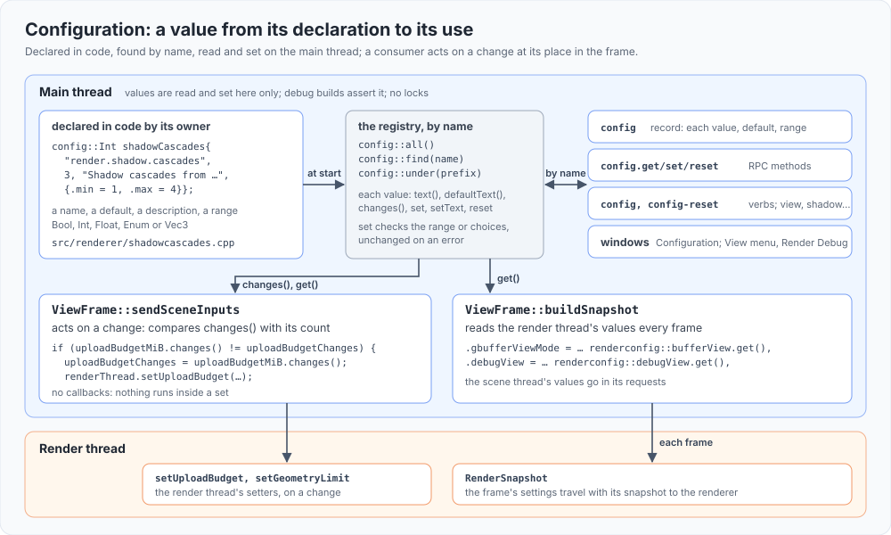

# Configuration

The engine's settings, in one system: each setting is a typed value declared in code by the part of the engine it configures, with a
dotted name, a default and a description. The library (`config`) is standard library only and sits beside `profile` and `trace`: any
library may declare values, and nothing in it knows the engine.



## Declaring a value

A value is a variable of one of the types below, declared where it belongs and registered by name when the program starts:

```cpp
// src/renderer/shadowcascades.cpp
config::Int shadowCascades{"render.shadow.cascades", 3, "Shadow cascades from the camera out to the shadow distance; the atlas has room for four.", {.min = 1, .max = 4}};
```

A header names the values other code reads (the renderer's are in `src/renderer/renderconfig.h`; the others in the header of the part that
declares them). A window shows a value another library declares by its name (`configCheckbox`, `configBool`, `src/ui/configwindow.h`),
so it doesn't include that library. The registry is a function-local static,
so the order translation units construct their values in doesn't matter; a name declared twice asserts.

| Type | Holds | Set from text |
|---|---|---|
| `config::Bool` | a bool | `true`/`false`, `on`/`off`, `1`/`0` |
| `config::Int` | an `int64_t`, an optional range | a whole number in the range |
| `config::Float` | a `double`, an optional range | a number in the range |
| `config::Enum` | one of named choices, as its index | a choice's name |
| `config::Vec3` | three floats: a colour or a vector | `x,y,z` |

`set` checks the range and the choices and leaves the value unchanged on an error, which says why; `setText` parses first. Every value has
`text()`, `defaultText()`, `reset()`, `isDefault()` and its description, which is what the record, RPC and the window read.

## Names

Dotted, by system then subject: `render.*` the renderer's (views, overlays, shadows, sampler, ambient, culling, budgets), `scene.*` the
scene's (purposes), `view.*` the view's runtime (the camera modes), `tools.*` the tools' (the debug camera, the LOD and Streaming layers,
the viewport overlays). For example `render.shadow.cascades`, `render.sampler.anisotropy`, `render.view.debug`. A value's group is its name's
first two parts (`render.shadow`); a prefix selects every value under it (`config-reset render.shadow`, `config.get {name: "render"}`).
The names are meant as an init file's keys once there is one: `name = value`, the value as `setText` takes it.

## Threads

Values belong to the main thread: they are read and set there only, and debug builds assert it (the first thread to touch a value owns
them all). What another thread needs goes to it as it did before: the render thread's settings in the `RenderSnapshot` (the main thread fills
it from the values each frame) or through the render thread's setters, the scene thread's in its requests. No locks.

## Acting on a change

A value counts every set that changed it (`changes()`). Code that must act when a value changes keeps the count it last acted on and
compares, in its place in the frame: the upload budget and the geometry pool's limit are handed to the render thread that way (`ViewFrame::sendSceneInputs`).
There are no callbacks, so nothing runs inside a `set`.

## At runtime

- **Record**: `config`, every value with its name, type, value, default, whether it is the default, its description, and its range or
  choices.
- **RPC**: `config.get {name?}` (one value by name, or every one under a prefix), `config.set {name, value}` or `{values: {name: value}}`
  (checked together: nothing is set when one fails; `reset` names values put back to their defaults first), `config.reset {name?}`.
- **Verbs**: `config <name> <value>`, `config-reset [<name or prefix>]`. Older verbs that set settings (`view`, `debugview`, `shadow`,
  `sampler`, `ambient`, `prepass`, `aa`, `gpuscene`, `cull`, `overlay`, `purposes`, `lod-show`, `streaming-show`, `camera-follow`,
  `debug-camera`) are kept as short forms that set the matching values.
- **Window**: Windows > Configuration (`window config`): every value by group with an editor for its type, its description and default on
  hover, values changed from their default marked, reset per value and per group. The View menu and the Render Debug window's controls edit
  the same values.

## Not yet

- An init file, and keeping changed values across runs: the names are its keys.
- Per-project defaults, strings and lists: when a setting needs one.
