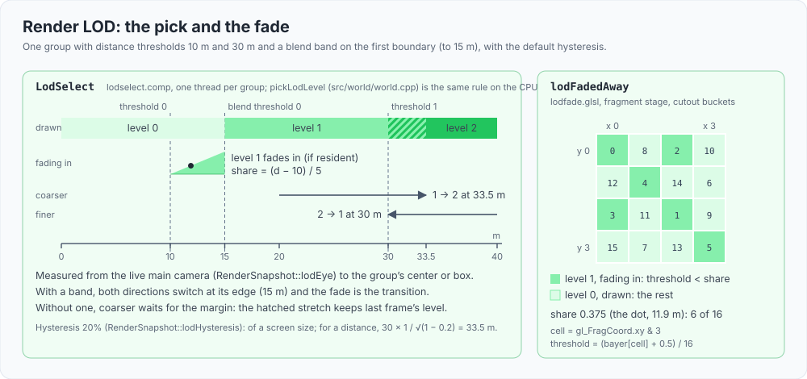
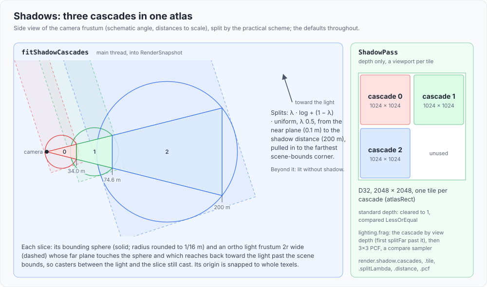
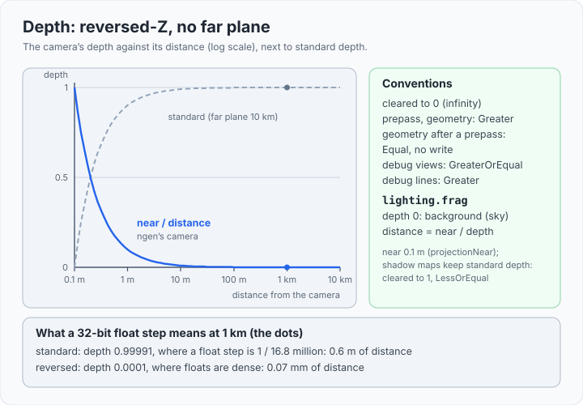
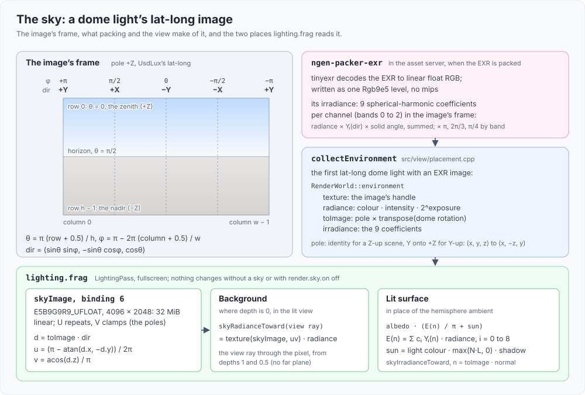
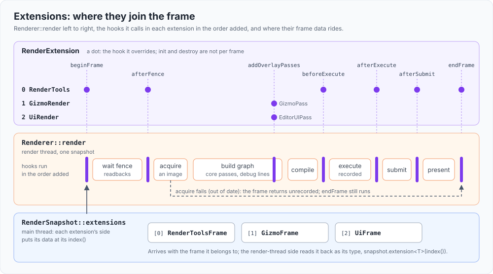

# Renderer

`src/renderer/` turns the scene's render data (`RenderWorld`) and a per-frame `RenderSnapshot` into GPU work. It runs on a dedicated render thread,
builds a frame graph every frame, draws the scene GPU-driven as meshlets with task and mesh shaders, and talks to the GPU only through the RHI
(`src/rhi/README.md`). This file describes how the renderer is structured, how its components fit together, and the rules the code relies on. Read it before adding a pass or
changing how scene data reaches the GPU.

## Principles

- **GPU-driven is the only path.** Scene data lives in persistent GPU tables; visibility and draw lists are produced on the GPU; the mesh passes issue one
  indirect draw per pipeline bucket per view, drawn by task and mesh shaders meshlet by meshlet. There is no CPU-driven or indexed fallback to keep in sync.
- **The frame graph owns ordering and barriers.** A pass declares what it reads and writes; the graph orders passes, culls unused ones, allocates transient
  textures and inserts every texture and buffer barrier. Passes do not record barriers for graph resources.
- **Deterministic output.** The same scene and camera produce the same pixels, run to run. Screenshots leave the UI out: the frame that takes one
  skips the editor UI pass, unless `setScreenshotsShowUi(true)` (ngen-view's `--show-ui`). Screenshots are compared byte for byte, so anything that
  reorders draws (for example atomic appends) is a behaviour change, not an implementation detail.
- **The render thread owns the GPU.** The main thread never records or submits. It hands over values (snapshots, uploads) and receives values back
  (debug snapshots, culling results).
- **What the CPU shows about the GPU is read back.** Culling results, draw counts, the draw log and GPU timings arrive after the frame slot's fence, one
  frame-slot cycle late.

## Layout

| Area | Files |
|---|---|
| Orchestration | `renderer.h/.cpp` (`Renderer`), `renderthread.h/.cpp` (`RenderThread`), `rendersnapshot.h`, `renderworld.h`, `renderertypes.h` |
| Frame graph | `framegraph.h/.cpp`, `framegraphbuilder.h`, `framegraphcontext.h`, `framegraphresource.h`, `passnode.h`, `framegraphdraw.h`, `framegraphdebug.h`, `resourcepool.h/.cpp` |
| GPU scene and culling | `gpuscene.h/.cpp` (`GpuScene`), `drawlists.h/.cpp` (`DrawLists`), `passes/instanceuploadpass`, `passes/instancecullpass`, `culling.h/.cpp` (`CullState`) |
| Meshlets and occlusion | `shaders/meshlet.glsl`, `meshlet.task` and the `*.mesh` shaders (every mesh pass), `depthpyramid.h/.cpp` (`DepthPyramid`), `shaders/hzbbuild.comp`, `hzb.glsl` |
| Passes | `passes/`: shadow, depth prepass, geometry, debug views, lighting, AA, blit, debug lines, present |
| Resource lifetime and upload | `deletionqueue.h/.cpp`, `gpuuploader.h/.cpp` |
| Pipelines | `pipelineregistry.h/.cpp` (`PipelineRegistry`): every pipeline and shader module |
| Shadows | `shadowcascades.h/.cpp` |
| Extensions | `renderextension.h` (`RenderExtension`, `RenderExtensionData`, `RenderFrame`), `previewtextures.h` (`PreviewTextures`) |
| Debugging and introspection | `capture.h/.cpp` (`CaptureService`), `gpuschema.h/.cpp`, `scenegpustats.h`, `debugview.h` |

What isn't the renderer's core joins its frame as an extension ("Extensions", below): its instrumentation in `src/rendertools`
(`src/rendertools/README.md`), the gizmos in `src/tools`, the UI in `src/ui`. Nothing in this library includes ImGui or a tool.

Shaders live in `shaders/` at the repository root. They are packed assets, streamed from the asset server (`src/asset/README.md`) and turned into
pipelines by the pipeline registry ("Pipelines", below).

## Pipelines

`PipelineRegistry` creates every pipeline the passes draw with, and nothing else creates one.

- **A pass registers its pipelines in `init()`, as requests**: the RHI pipeline description with shader ids (`ShaderRef { id, stage }`) in
  place of modules, and owned arrays, so the registry can create the pipeline at any time. It gets a stable `PipelineHandle` and asks
  `registry.get(handle)` while the frame graph is built or recorded. Debug names are the registered names (`geometry.pipeline.cullback.less`).
- **Nothing waits for a shader.**
  - **At start or first use.** At-start pipelines (`PipelineUse::AtStart`) have their shaders requested at start-up, in one request
    (`Renderer::requestShaders`). First-use pipelines (`PipelineUse::FirstUse`, the debug views) request theirs the first time they are asked
    for (`get`, or `ready` for a group).
  - **Pending until made.** Either kind is pending, and `get` returns null, until `update()` has made it.
  - **Passes are left out until ready.** Each pass says when its pipelines are ready (`ready()`), and the frame leaves it out until then. Until
    the lit path is ready (culling, shadow, geometry, the prepass when on, lighting, AA), the frame is the backbuffer cleared to the background
    colour (`ClearBackbuffer`), the overlays whose pipelines are ready, and the UI. The scene uploads go on meanwhile.
  - **A failed pipeline doesn't stop the view.** When a shader fails to pack, its pipeline is failed and its pass stays out. The reason is in the
    trace and the pipeline's info, `--fail-on-validation` makes the run exit with 2, and a fixed source retries it (hot reload, below).
- **One point in the frame.** `update()` runs on the render thread before the frame graph is built: it creates pending pipelines whose shaders
  have arrived (polling `AssetClient::find`, so the render thread never waits on the network), at most four per frame. Nothing changes a
  pipeline during a frame's recording; debug builds assert it.
- **Shader modules are shared.** One module per shader id, for every pipeline that uses it (`shaders/shadow.frag`: the shadow pass and the
  depth prepass).
- **Observable.** Events `ShadersRequested`, `ShaderLoaded` (id, version), `PipelinePending`, `PipelineCreated`, `PipelineCreateFailed`
  (reason), `ShaderPackFailed`; the `pipelines` record (name, `atStart` or `firstUse`, state, shaders and versions, the last error) and the Render
  Debug window's Pipelines tab.
- **Hot reload.** `reload(ids)` (the renderer's `reloadShaders`, with the ids the asset server said changed) requests the shaders it has
  modules for again. When the request is answered, `update()` creates the new module and recreates every ready pipeline using it; the handle
  keeps its index, and the old pipeline and module go to the deletion queue, since frames in flight may use them. A failed pipeline using the
  shader, including one whose shader never made a module, is tried again. A shader that fails to pack or to become a module keeps the old module and pipelines, with the error in the trace
  (`ShaderReloadFailed`) and the pipelines' info until a later version loads or the source goes back. Events `ShadersReloadRequested`,
  `ShaderReloaded` (version, pipelines recreated), `PipelineRecreateFailed`.
- **Not yet**: shader reflection, creation off the render thread, a disk pipeline cache.

## How the pieces fit

### A mesh from pack to pixels

Meshlets are the renderer's only geometry path: every pass that draws meshes (the shadow cascades, the depth prepass, the geometry pass, the
debug views) draws meshlets with task and mesh shaders, and there is no vertex-shader or indexed fallback. A mesh is split into meshlets when it
is packed; the GPU scene keeps them in the geometry pool; culling turns each frame's visible instances into meshlet work per view and bucket;
the task shader culls meshlets and the mesh shader emits their triangles. The sections below take each step in turn: "Scene data on the GPU",
"Culling and draw lists", "Occlusion culling" and "Meshlets".

![A mesh's path from pack time to pixels: the packer welds vertices, orders triangles and splits each submesh into meshlets of at most 64 vertices and 124 triangles with a bounding sphere and normal cone; the GPU scene holds them in the geometry pool, mesh table and per-slot instance and culling records; instance culling compacts every drawn instance's meshlets into work items per view and bucket; then in every mesh pass one drawMeshTasksIndirect per region runs task shaders that cull each meshlet and pack the survivors, and mesh shaders draw one pack per workgroup](../../screenshots/renderer_meshlet_path.svg)

### Threads and handoff

- **`RenderSnapshot`** (main to render, every frame): view and projection, world up, window size, view mode and overlay toggles, AA and depth
  prepass switches, material sampler settings, the culling frustum (`cullViewProj`, live or frozen) and `cullEnabled`, shadow settings and the fitted
  cascades, debug line data, the capture watches when they changed, and each extension's data for the frame (`extensions`: the render tools'
  requests, the gizmos' lines, the cloned ImGui draw data). One slot with back-pressure: the main thread blocks if the render thread has not taken
  the previous snapshot.
- **`SceneChanges`** (main to render, on scene changes): what changed, with the added meshes' and textures' data shared, applied at the start of the
  next render frame. Lists submitted between two frames are appended and applied together, in order.
- **Back to the main thread**, non-blocking: `CullResult` (latest-only, every new readback), the capture results, and what the extensions hand
  back on their own (the render tools' snapshots, counters and screenshots).
- **Settings** go to the `RenderThread` under a lock, applied before the next frame: the upload budget, the geometry limit, shaders to reload.

### Renderer

`Renderer` owns the device-facing state: the swapchain, the depth texture, the per-slot UBOs and sync objects, `GpuScene`, `DrawLists`, the passes,
`FrameGraph`, `ResourcePool`, `DeletionQueue`, `GpuUploader` and the texture cache. Its entry points:

- `init`: swapchain, samplers, fallback texture, every pass's pipelines, `GpuScene` and `DrawLists` (the instance buffer exists from here on), frame
  sync, the capture service, then each extension (`addExtension(extension, name)`, before `init`; the name labels the extension's hook
  zones in the profiler, `RenderTools.beginFrame` and so on, one detail zone per hook call).
- `applySceneChanges`: what changed in the scene (`SceneChanges`, the render thread's `submitSceneChanges`) applied to the GPU scene piece by
  piece, its uploads queued ("Scene data on the GPU", below); `flushSceneUploads` records them all and waits, for the first frame.
- `render`: one frame (below).
- `destroy`: waits idle, drains the deletion queue, destroys in reverse.

**Frame slots.** The renderer keeps one slot per swapchain image. A slot owns its command buffer, in-flight fence, image-available semaphore, view UBO,
instance staging buffer, culling buffers and readback buffers; the slot's fence guards all of them. The render-finished semaphore belongs to the swapchain
image, because present consumes it per image.

**A frame (`Renderer::render`).**

1. Wait for the slot's fence. Drain the deletion queue up to that slot's last frame, read its GPU zones (profiler lane) and its culling
   readback.
2. Acquire a swapchain image; on `OutOfDate` recreate the swapchain and depth texture and skip the frame.
3. Write the slot's view UBO. Pick the shadow light and the cascades (from the snapshot, or one fitted here if the snapshot has none).
4. Build the frame graph: import backbuffer and depth, add the instance upload, the culling passes, the draw passes, the readback, lighting, AA,
   overlays, UI and present.
5. Compile, then execute into the slot's command buffer. Screenshot and texture-dump copies are recorded after the graph.
6. Submit with the image-available and render-finished semaphores and the slot's fence, present, advance the slot.

## The frame graph

- **`FrameGraph`** holds the passes and resources of one frame. `reset()` clears it, `importTexture`/`importBuffer` add external resources,
  `addPass<Data>(name, group, setup, execute)` adds a pass, `compile()` orders and culls, `execute(cmd)` records. `group` is the pass's profile
  group (`src/profile/README.md`): the colour of its CPU record zone and its GPU zone.
- **`FrameGraphBuilder`** is what a pass's setup sees: `createTexture`, `read`/`write` for texture and buffer handles with an `FgAccessFlags` value
  (`ColorAttachment`, `DepthAttachment`, `ShaderRead`, `StorageRead`, `StorageWrite`, `TransferSrc`, `TransferDst`, `IndirectRead`, `Present`), and
  `setSideEffects`.
- **`FrameGraphContext`** is what a pass's execute sees: the command buffer, `texture(handle)`/`buffer(handle)` for the physical resources, `logDraw`
  for the draw log and `addIndirectStats` for draws the RHI cannot count.
- **Compile.** Edges run from each resource's writer to its readers and between consecutive writers; a topological sort gives the execution order.
  Passes without side effects whose outputs nobody reads are culled (`culled` in the `render` record's passes). Transient texture lifetimes are computed over the order.
- **Execute.** Per pass: allocate transient textures that start here from `ResourcePool`, derive and record the barriers for every declared access, run
  the pass inside a debug label, a GPU zone and a CPU profile zone, record its `RhiCommandStats`, then release transients that end here.
- **Textures.** Created textures are transient and pooled by size, format and usage. Imported textures start every frame undefined; that is right for
  the backbuffer and for a depth buffer that is cleared each frame.
- **Buffers.** Imported only. `importBuffer(..., initialAccess)` takes the access the previous frame left the buffer in and `finalAccess(handle)` returns
  it after `execute`, so a persistent buffer synchronises across frames; the caller keeps that state next to the buffer. Per-slot buffers import with no
  prior access, since the slot's fence already ordered them. Read-after-read of the same kind needs no barrier; anything involving a write does.
- **Stats.** A pass's stats include the barriers the graph issued for it.
- **Debugging.** `buildDebugSnapshot()` feeds the Frame Graph window (pass list, resources, node view). With the window open, `FrameGraphPreviews`
  captures a thumbnail of each colour texture at its last use through the debug capture hook.

## Scene data on the GPU

`GpuScene` owns the scene's GPU tables, and changes them piece by piece. The view hands the renderer `SceneChanges` (`renderworld.h`): meshes,
textures and materials added and removed, draw slots changed, the lights. `Renderer::applySceneChanges` applies them in a fixed order:
- **Removals first**, so what is added reuses their pool ranges, table entries and texture slots. A whole-scene repack then doesn't grow the pool.
- **Then textures, meshes and materials**, before the draws that name them.
- **Then the draw slots.**

Applying only queues uploads. Nothing waits.

Tables:

- **Geometry pool.** One interleaved `Vertex` buffer, one position-only buffer (12 bytes per vertex), the meshlets (`GpuMeshlet`, 32 bytes), their
  vertex indices (32-bit, mesh-local) and their triangles (one 32-bit word each, three meshlet-local indices); every buffer is read by the mesh shaders
  as a storage buffer. There is no index buffer: the meshlets draw every triangle.
  - **A range per mesh in each**, from a first-fit allocator (`PoolAllocator`) per buffer that merges neighbouring free ranges. A mesh is one mesh asset,
    shared by every prim that places it.
  - **Growth.** When a range doesn't fit, a buffer twice the size replaces the old one. The old contents are copied on the GPU before this frame's
    uploads, and the old buffer is retired.
  - **Limit.** No pool buffer grows past the device's largest buffer (`RhiDeviceLimits::maxBufferBytes`, whole MiBs), or a smaller limit
    (`setGeometryLimit`, ngen-view's `--geometry-limit=<MiB>`). The vertex stream reaches it before the position stream and sets the vertex capacity
    of both. A mesh that doesn't fit waits, with an empty mesh table entry, so its draws draw nothing while the rest of the scene draws; the
    first one traces `GeometryPoolFull` (a warning). Once a frame after removals freed ranges, the waiting meshes that fit are placed, in
    arrival order (`GeometryPoolFits` when none is left). The `memory` record's `geometryPool` has the limit, capacities, use and what waits.
  - **Addressing.** A meshlet's vertex indices stay mesh-local and the shader adds the mesh's `vertexOffset` (the vertex and position pools share
    it); a meshlet's own offsets are made pool positions when it is uploaded.
  - **No compaction.**
- **Mesh table.** `GpuMeshEntry` per `MeshHandle::index`: `vertexOffset`, `meshletOffset`, `meshletCount`, `triangleCount`. Handles are never reused.
  A mesh whose data hasn't been copied yet, or was removed, has `meshletCount` 0 and isn't drawn. The table grows like the pool, and the part past the old contents is
  zeroed.
- **Textures and slots.**
  - **One GPU texture per `TextureHandle`**: a texture asset, or a generated 1×1 of a constant colour, shared by the materials naming it.
  - **Created late.** It is created when its first level is copied, so creating large textures follows the upload budget.
  - **A slot once complete.** It takes a slot in the texture array once every level is copied, at the start of the next frame (`beginFrame`). Slot 0
    is the fallback texture and slot 1 a white 1×1, which a material samples while its texture uploads. Freed slots are reused, up to
    `GpuScene::maxTextures` (1024).
- **Material table.** A `GpuMaterial` entry per `MaterialHandle`; freed entries are reused.
  - **Contents**: the base colour texture slot and, for a cutout material, the opacity: its texture slot (the base colour's when the opacity is that
    texture's channel), the channel and raw flag (`opacityInfo`), and the threshold.
  - **Rewritten when a texture it names takes its slot.** Until then it samples the white texture, and a cutout whose opacity texture is still
    uploading draws opaque.
- **Instance buffer.** One `GpuInstanceRecord` (128 bytes, std430) per draw slot.
  - **Contents**: model matrix, material entry, mesh index, the submesh's meshlets (`meshletOffset` from the mesh's first, `meshletCount`) and
    `triangleCount`, world bounds (the submesh's box: `SubMesh::bounds`, from its triangles when the view loads the mesh), flags
    (`doubleSided`, `boundsValid`, `cutout`), the drawn LOD level + 1 of the LOD root above it (0 under none), which the geometry pass
    writes to the normal target's alpha for the LOD level view (with its group's flags: "Render LOD", the LOD tag), its render-LOD group + 1
    (0 for none), its streaming root's slot + 1 (`streamRoot`, 0 under none) for the streaming view, and how many LOD roots it is under
    (`lodDepth`, 0 under none) for the LOD level view.
  - **Slots.** A draw keeps its slot while it exists. A removed one is dead (mesh index past the table, so culling never draws it) until a new draw
    takes it.
  - **Reading it.** The task and mesh shaders read it at the slot their draw command names.
  - **Uploads.** Only the changed records go up: packed in the slot's staging buffer (grown up to 4 MiB; a larger upload, as a tile switch's or
    after the buffer grew, takes a staging buffer of its own for its frame), and copied by the `InstanceUpload` pass in one copy with a region per
    run of consecutive slots (`RhiCommandBuffer::copyBufferRegions`). The `gpuscene` record has the last upload's records and regions. The buffer
    grows by recreation.

**Uploads** (`GpuScene::addUploadPass`, the `SceneUpload` pass, before the culling passes):
- **Per frame.** Each frame takes queued uploads in order, up to `uploadBudget` bytes (64 MiB; at least one upload, so a large texture level still
  goes). A texture's levels are separate uploads.
- **Seen from outside.** After every frame the render thread publishes `SceneGpuStats` (`RenderThread::latestSceneGpuStats`): change lists
  submitted and drawn, the tables' sizes, the upload queue (`GpuScene::uploadStats`: queued, budget, the last pass, textures waiting for their
  slot), the geometry pool, the last frame's commands summed over the passes that ran (`frameCommands`, `FrameGraph::frameStats`) and the
  device's memory heaps (`heaps`). Then it reports the device's allocations to Tracy's "GPU" memory pool while a Tracy server is connected
  (`Renderer::reportGpuAllocations`, `src/profile/README.md`). The budget and the pool limit are runtime settings (`RenderThread::setUploadBudget`, `setGeometryLimit`), applied
  before the next frame.
- **One staging buffer per frame's batch**, retired through the deletion queue.
- **Barriers.** The copies are recorded in the frame's command buffer:
  - before them, a barrier from the tables' and pool's read states to transfer;
  - one between a grown buffer's move and the uploads, since copies in one command buffer may run in any order;
  - one back after.

  On one queue a barrier also orders against earlier submissions, so ranges freed this frame are written at once.
- **Start-up.** `Renderer::flushSceneUploads` records everything on `GpuUploader`'s command buffer and waits, so the first frame has the scene.
- **Descriptor sets.** When the texture slots change or a table or buffer is replaced, the descriptor sets naming them are rewritten at the next frame
  (`Renderer::rebuildGeometryDescriptorSets`, which also rebuilds the culling sets; the old sets are retired).

`GpuInstance` is the CPU mirror the renderer keeps (`Renderer::gpuInstances`), by draw slot.

## Culling and draw lists

`DrawLists` defines the command layout and owns the per-slot culling buffers; `InstanceCullPass` runs `shaders/instancecull.comp` in six modes: cull,
scan, layout and scatter for every view, occlusion for the camera's second phase ("Occlusion culling"), and clear for a new history buffer.

- **Regions.** One region per (view, bucket), four buckets per view (`DrawLists::bucket`): single-sided (back-face culling), double-sided, and the
  same two for cutout materials. View 0 is the camera, views 1..4 the shadow cascades, view 5 the camera's second phase of occlusion culling
  (below). A prim's mesh draws as one instance per submesh, in every view: each region holds the visible instances with a mesh in the pool,
  each drawing its submesh's meshlets and culled by its submesh's box, so one submesh of a large mesh can be culled while another is drawn.
  (Cascades once drew a prim's whole mesh from its first instance; with one draw per region that saved nothing, and it needed the mesh's box.)
- **Region sizes.** An instance's bucket follows from its flags and is the same in every view, so it can land in one region per view. The
  renderer keeps the live instances per bucket as slots change (`DrawLists::countInstance`, the shader's bucket rule on the CPU), and each frame
  `writeParams` packs the regions one after another, each as large as its bucket's count (`CullParams::regionOffsets`): the draw record buffer
  holds the live instances once per view, not every instance in every region. The scatters never write past a region's end; a record they
  drop there is counted (`counterRegionOverflow`, the `culling` record's `regionOverflow`) and traced (`CullRegionOverflow`, a warning, once
  per change): the CPU's bucket rule and the shader's disagree, and those draws are missing from the tools. It is 0 otherwise.
- **Visibility.** Each instance's world bounds are tested against six normalized planes per view (`Frustum::fromViewProj`, computed on the CPU into the
  slot's parameter buffer) with the positive-corner test. Instances without valid bounds are always visible, and with culling off every instance is. A
  frozen frustum is only a different camera matrix in the snapshot (`CullState`).
- **What culling reads.** The culling passes read a 48-byte culling record per slot (`GpuCullRecord`: bounds, flags, LOD level and group, mesh,
  meshlet range, triangles), kept in the instance buffer after the 128-byte draw records (`GpuScene::cullRecordsOffset`) and uploaded with
  them; only the task and mesh shaders read the draw record. Visiting 3 million slots several times a frame is bound by memory: reading the
  draw record there cost the test world 4 to 7 ms a frame.
- **Group boxes.** Each workgroup of 256 slots has a box around its live slots' bounds (`GroupBox`, `DrawLists::updateGroupBounds`, recomputed
  for the groups whose slots changed, copied into the slot's `cull.groupbounds` each frame). `InstanceCull` tests it first: a group outside every
  view writes its slots' visibility and cull codes (the group's rejecting plane per view) without reading them, and counts its live slots
  culled (the box's `w`, a count the CPU keeps; a dead slot counts in no view's statistics, tested or not). The test is
  monotonic in the box, so a slot it skips is one its own test would have culled. Render-LOD slots in a skipped group count as culled, not as
  levels not drawn, and don't mark their residency (no view sees them).
- **Ordered compaction (reduce-then-scan).** `InstanceCull` counts, per workgroup of 256 instances, how many commands each region gets.
  `InstanceCullScan` turns the per-workgroup counts into start offsets and totals, one workgroup per counter, 256 workgroups at a time with
  subgroup prefix sums (`workgroupExclusiveSum`); `InstanceCullLayout` then lays the regions out in the work items from the totals.
  `InstanceCullScatter` writes each command at its workgroup's offset plus its position in a shared-memory prefix sum; it skips a region its
  workgroup has nothing in (the workgroup's own counters say), a workgroup with nothing in any, and the instance reads of slots not drawn. Commands
  stay in instance order, so draw order and depth-tie resolution match run to run. Atomic appends would be simpler but make the order depend on
  scheduling.
- **Draws.** A region is one draw over its *work items*: every drawn instance's meshlets as `{instance, meshlet}` (`MeshletWorkItem`), in
  instance order, in the frame slot's one work item buffer (`cull.workitems`). `InstanceCullLayout` lays the regions out in it one after another and
  writes each region's draw (`RegionWork`: the task workgroups, 32 meshlets each, wrapping into y past 32,768, and the range); a task workgroup takes
  any 32 consecutive items, whatever their instance. An instance's items are its submesh's meshlets. The buffer holds twice the live
  instances' meshlets and grows when a frame's items didn't fit (`MeshletWorkGrown`; those meshlets weren't drawn that frame).
- **Draw records.** Beside the items, one `DrawRecord` per drawn instance per region (instance, meshlets, first item), at the region's offset:
  what the draw log, the GPU Scene window and the frame debugger read. They come back to the CPU only while the render debugger asks, into a
  readback of their own (`cull.readback.commands`), let go the first frame it doesn't.
- **Counts and statistics.** The totals buffer holds the draws per region, the instances' triangles per region, camera-culled instances, and
  culled and drawn instances per cascade. The scan also zeroes the frame's meshlet counts.
- **Per-slot buffers.** Parameters, visibility, counters, offsets, commands and counts are per frame slot and imported every frame. The
  per-instance ones grow with the instance count, the draw record buffer with the instances counted in the buckets. The graph has no
  transient buffers yet: a pooled buffer reused next frame would need synchronisation against the previous frame's reads.
- **Readback.** `CullReadback` (ordered by the graph after the scatter, so it may run after the shadow pass and the prepass) copies the totals into the slot's host-visible readback buffer, the visibility bits too for a frame whose snapshot asks
  (`RenderSnapshot::readVisibility`, while the culled overlay is on: at 2.4 million instances parsing them cost 1.5 ms a frame), and while the render debugger
  is open the commands into the slot's commands readback, made when it is asked for and let go the first frame the slot's frame isn't; `DrawLists::parseReadback` reads them after the slot's
  fence, each region at the offset that frame laid it out at. `CullResult` (the view's `culling` record, Culling window, AABB
  overlay), the per-pass `draws`/`primitives` (through `addIndirectStats`) and the draw log all come from there.

The mesh passes bind the pipeline and the geometry set once per bucket, push the region (`MeshletPush`), and issue one `drawMeshTasksIndirect`
whose command is the region's `RegionWork` (`DrawLists::drawRegion`). An empty region still costs one call; only the GPU knows the count.
One draw per instance, the first way this was built, cost about 0.25 µs a draw on RADV: 92 ms at the test world's foliage, against 30 ms
indexed.

## Occlusion culling

Two phases against a depth pyramid built from the first (`DepthPyramid`, `depthpyramid.*`; `InstanceCullPass::addLatePasses`;
`shaders/hzbbuild.comp`, `hzb.glsl`). By default they run in the geometry pass (`GeometryPhase`): `GeometryPass` draws the first phase into the
G-buffer, `HzbBuild` builds the pyramid from its depth, the second phase's culling runs, and `GeometryPassLate` draws what the pyramid newly shows
onto the same targets, its meshlets tested against the pyramid. The first phase's meshlets aren't tested. Drawing every visible instance twice
(prepass, then geometry) cost more than occlusion saved: at the test world's overlook the prepass phases took 11.5 ms. With the depth prepass on
(`render.prepass`), the phases run in the prepass instead, as follows:
1. **First phase.** The cull pass puts in the camera's regions only the frustum-visible instances the camera saw last frame: the *history*, a
   word per instance slot kept across frames (`cull.history`, cleared when it is made). `DepthPrepass` draws them.
2. **The pyramid.** `HzbBuild` reduces that depth, `R32_SFLOAT`, mip 0 the depth's size rounded down to powers of two (every depth texel a mip-0
   texel touches is taken), each level the minimum (reversed-Z: the farthest) of the 2×2 below, one dispatch per level. The whole pyramid is
   `General` for the pass; between dispatches a `General` to `General` barrier (`FrameGraphContext::storageBarrier`, listed with the graph's
   barriers) makes one level's writes visible to the next.
3. **Second phase.** `InstanceCullOcclusion` tests every frustum-visible camera instance's box against the pyramid (the level where its screen
   rectangle spans at most two texels a side, four texels read): hidden ones lose their camera bit (cull code `C`); the history becomes what
   shows; those that show and weren't drawn first go to view 5's regions (`InstanceCullLateScan`, `InstanceCullLateScatter`, ordered as the
   first phase). `DepthPrepassLate` draws them, its task shaders testing each meshlet's sphere against the same pyramid
   (`meshletFlagOcclusion`).
4. **The final pyramid.** `HzbBuildFinal` rebuilds the pyramid from the prepass's whole depth (both phases).
5. **The geometry pass** draws both phases' regions with the `Equal` test, every meshlet tested against the final pyramid. That is safe:
   a meshlet that wrote depth anywhere has its own depth at a texel its rectangle covers, so the farthest depth there is no nearer than
   its nearest point and the strict test keeps it; one the test hides lies behind the stored depth at every pixel and would shade
   nothing. So the geometry pass shades only meshlets that show, while a still camera's first phase (every meshlet of what showed last
   frame) is still drawn whole by the prepass, which makes the occluders.

- **What it never removes.** Only what is behind depth already drawn is culled, so a still camera gives the same image with occlusion on and
  off (with the prepass on in both: the prepass path resolves a few depth ties differently from the direct path). After a camera cut the
  first frame draws everything that shows in its second phase.
- **When it is off.** `occlusion off` (`render.culling.occlusion`, the Culling window) or culling off; the history is then left as it is.
- **From the culling camera.** Culling (frustum, cone, occlusion) is the culling camera's: the main camera, also while a debug camera renders
  (`tools.debugcamera.cull` hands it to the debug camera), or the frozen frustum. While that isn't the camera rendered
  (`RenderSnapshot::cullCameraSeparate`), both phases draw from it (`DepthPrepassCull`, `DepthPrepassCullLate`; the UBO's `cullViewProj`,
  `meshletFlagCullCamera`) into a depth buffer of its own (`renderer.depth.cull`, imported as `depth.cull`), which the pyramid builds read
  (`DepthPyramid::Source::Culling`); the rendered view has no prepass and the geometry pass tests and writes depth itself, its meshlets
  tested against the culling camera's pyramid. So a debug camera shows exactly what the main camera's frame draws, occlusion included; the
  `culling` record's `occlusion.depthFrom` and the Culling window say which depth it was.
- **Why first-phase meshlets aren't tested in the prepass.** They are the occluders the pyramid is built from; testing them needs a
  history per meshlet, not kept.
- **Seeing the pyramid.** The `hzb` buffer view (`view hzb`, `--view=hzb`, the Culling window's "Show depth pyramid", the View menu) shows
  it at one level (`render.view.hzblevel`, `hzb-level <n>`, the Culling window's slider; past the last level, the last), each texel the
  farthest depth it covers, shaded as the depth view; dark red while occlusion didn't build it that frame. `LightingPass` reads the pyramid
  only while that view is on (binding 7 holds the depth otherwise), so the frame graph of every other view is unchanged.
- **The pyramid in every mesh pass's set.** The task shader binds it (binding 13), so every pass using the geometry set reads it in the graph,
  which keeps it in `ShaderReadOnly` wherever it isn't being built.
- **The graph's write-after-read edges** (`FrameGraph::compile`): a pass that reads a resource comes before the next pass that writes it, as
  `HzbBuild` reads the first phase's depth before `DepthPrepassLate` writes it. Those edges order passes but don't keep a reader alive.

## Meshlets

*Top: the test world at a `flight` viewpoint, lit and in the `meshlet` view. Bottom: Sponza's atrium in the `meshlet` view, and the
`meshletcull` view from a debug camera above the main camera: green meshlets are drawn, red ones fall outside the frustum, blue face away
and magenta are hidden by depth.*

Meshes arrive split into meshlets of at most 64 vertices and 124 triangles, each with a bounding sphere and a normal cone (the USD packer, with
meshoptimizer; `src/asset/README.md`). Every mesh pass draws them with task and mesh shaders (`shaders/meshlet.glsl`, `meshlet.task`, `*.mesh`).
- **Task shader** (`meshlet.task`, 32 threads, one meshlet each): the meshlets of its draw's instance in that view; the sphere against the view's
  frustum planes (from the culling parameters); for the camera's single-sided buckets the normal cone, when every triangle faces away from the
  culling camera (skipped for an instance whose model scales unevenly); with `meshletFlagOcclusion` the sphere's box against the depth
  pyramid. The survivors are compacted in meshlet order with a prefix over the workgroup (no atomics, no subgroup operations: the order
  never depends on scheduling). Classifying (`meshletFlagClassify`, the `meshletcull` debug view) every meshlet survives with the test that
  would cull it in the payload (`meshletFlagHiddenOnly`: only the ones depth hides).
- **Packs.** The survivors are packed in order, as many consecutive meshlets per mesh workgroup as fit in 64 vertices and 124 triangles
  (`packMaxVertices`, `packMaxTriangles`): a full meshlet takes a workgroup of its own, up to 32 small ones share one. The task shader writes the
  packs into the payload with each survivor's starts in its pack and its pool offsets, so a mesh lane reads neither the meshlet nor the mesh
  table. Grass and pebbles are meshlets of about 20 triangles, and a mesh workgroup each cost the geometry and shadow passes more than their
  triangles did. A pack of one meshlet reads the payload and its instance at uniform addresses; a pack of several copies its meshlets' words
  into shared memory once (`loadPackShared`), and each lane finds its meshlet by a binary search there (the payload lives in memory, not on
  chip, so per-lane payload reads cost more than the packing saved). Primitive order is the meshlets', so the image is the same.
- **Mesh shaders** (64 threads, a vertex and up to two triangles each, a pack per workgroup): `gbuffer.mesh`, `depth.mesh`, `depthcutout.mesh`,
  `shadow.mesh`, `shadowcutout.mesh` pull their vertices from the pool; `gbuffer.mesh` and `depth.mesh` share the position expression with
  `gl_Position` invariant. `debugview.mesh` takes half a meshlet per workgroup (`meshletFlagSplit`, no packs) and gives every triangle vertices
  of its own, for the wireframe's edges, the triangle's size and its index, in place of a geometry shader.
- **Tried and left out** (measured on the test world, AMD 890M): culling triangles in the mesh shaders (back faces and those covering no pixel
  centre; exact with a half-pixel margin, but the barrier and prefix it needs cost 1 to 3 ms more than the rasterizer saved); 32-thread mesh
  workgroups; subgroup counters in the task shader; 64 meshlets per task workgroup; packs of 128 vertices and 256 triangles (larger cascade
  meshlets left half the lanes idle); the normal cone in the shadow cascades (not what the rasterizer culls there to the pixel, for 0.2 ms).
- **Order.** Commands are in instance order and meshlets in meshlet order, and mesh shading rasterizes in draw, workgroup and primitive order, so a
  frame draws the same way every run. Against the indexed draws it replaced, Sponza differed by 2 or 3 pixels of 3.7 million, by at most 3 levels: depth
  ties resolved in a different order.
- **Counts.** The camera's geometry pass and the shadow pass (`meshletFlagCount`) add, per view, the meshlets tested, culled by the frustum, by
  the cone and by depth, drawn, and their triangles into the slot's meshlet counts (atomic sums, so their total doesn't depend on order), read
  back with the culling (`CullResult::cameraMeshlets`, `cascadeMeshlets`; the `culling` record, the Culling window). The prepass doesn't count.
  Drawn triangles everywhere (`CullResult::cameraTriangles`, `cascadeTriangles`, the status bar, the record's `triangles`) are
  these; what instance culling alone keeps is `instanceTriangles`. Culling reads in steps: the scene, what instance culling keeps, what
  meshlet culling draws.
- **Seeing it.** `debugview meshletcull` (`DebugViewPass`) draws every meshlet of the camera's drawn instances coloured by the test that
  culls it (kept, frustum, cone, depth) into a depth buffer of its own, then an x-ray of the meshlets depth hides, where they lie behind it;
  with the frustum frozen, frustum and cone culling show from elsewhere.
- **Work items.** The buffer is sized for every live instance's meshlets twice and grows when a frame overflows; a readback from a frame
  built before the last growth reports no overflow (it was answered).

## Render LOD

A render-LOD root (a UsdLod root whose levels aren't payloads; `src/world/README.md` "Loading") where the view places it is a *group*
(`RenderLodGroup`, slots in `SceneChanges::lodGroups` beside the draw slots): the heuristic the view's preference chose for it, in the GPU's
units (`RenderLodKind`: a screen size, the bounding sphere of its extent in world metres; or a distance, the root's transform and its inverse,
the heuristic's center and its bounding box, thresholds in metres), its thresholds and blend thresholds (up to 8 levels), its default and a
forced level (hand-set, or the default while the heuristic is off or the group has none usable). Every level's draws are slots tagged with the
group (`lodGroup`) and their level (`lodLevel`). Each frame the GPU picks the level a group draws, and culling draws only that level's slots, or,
inside a blend band, that level and the next, cross-faded. `LodGroups` (`lodgroups.*`) holds the buffers; `LodSelectPass`
(`passes/lodselectpass.*`, `shaders/lodselect.comp`) adds `LodSelect`, which runs before the culling passes, and `LodSelectSum`, which the
frame graph orders in among them, as it orders every pass by what it reads and writes (`LodReadback` follows the sum).

- **The table** (`gpuscene.lodgroups`, `GpuLodGroup`, 240 bytes): uploaded as groups change (`LodGroupUpload`, the changed span through the
  slot's staging, as the instance records). A slot taking a new group gets a new serial.
- **The pick** (`LodSelect`, one thread per group): the forced level, else the level the group's heuristic wants from the live main camera (`RenderSnapshot::lodEye`, which a debug camera rendered from
  leaves where it is), as
  `pickLodLevel` (`src/world/world.cpp`) picks it: UsdLod's `ComputeLOD` for a distance (to the center, or the nearest point of the box, 0 inside;
  `ComputeDistance`) or a screen size (the sphere over the view window at depth 1), with its blend bands, and at a boundary without one a
  margin before going coarser (the hysteresis, the view's tuning as a push constant, `RenderSnapshot::lodHysteresis`, 20% of a screen size by default; a distance's threshold grows by 1/√0.8, about 12%, as a size falls with
  the distance's square),
  against the level the group wanted last frame. A bias and threshold overrides are the view's too, baked into the group's thresholds. Then the level drawn: the wanted one when its meshes are in the
  pool, else the one drawn last frame when they are, else the nearest resident level, coarser first. Inside a band, when the wanted level is
  drawn and the next one is resident, the next one fades in with the band's share. Written to the state buffer (`gpuscene.lodstate`, 16 bytes a
  group: the serial; the level wanted, drawn and fading in, a forced bit and the pop flash's frames left; the share; the measure).
- **Pops.** A drawn level that changes without a fade leading into it or out of it (no band, a forced level, a fallback, blending off) is a
  pop: counted (`LodSelectTotals::popped`) and flashed for half a second at the view's frame rate (`RenderSnapshot::lodFlashFrames`, at most
  127 frames). `LodStateFlags` read the forced bit and the flash back per group.
- **The LOD tag.** `gbuffer.mesh` writes the draw's tag to the normal target's alpha (`lodTag`, `lodfade.glsl`): the drawn level + 1, plus
  16 at a forced level, 32 drawing another level than wanted, 64 flashing, and 128 per LOD root the draw is under (`lodDepth`, at most 15,
  so the tag stays exact in a 16-bit float). The LOD Level view lays a colour at half strength over the lit colour: the drawn level's
  (a ramp), or with `RenderSnapshot::lodColorByDepth` the depth's (a level's index means a different resolution at each depth), and stripes
  or checkers by the flags; with `RenderSnapshot::lodPopFlash` the lighting pass tints a flashing draw white over any view. The tag and the
  fade's coverage travel as one flat `uvec2`, so the opaque fragment shader, which reads only the tag, still consumes the varying.
- **Fades.** While a group fades, the cull pass draws both levels' instances in the cutout buckets of their sidedness, whose pipelines discard
  (`cutout.glsl`); their mesh shaders read the group's state from the geometry set (binding 15, declared as a read by the passes drawing the
  lists) and pass the instance's coverage flat, and the fragment stages discard by a 4×4 ordered (Bayer) pattern in screen space
  (`lodfade.glsl`): the level fading in keeps the pattern's values below the share, the level drawn the rest, so every pixel is covered once.
  The depth prepass, the geometry pass and the shadow cascades dither alike. The CPU counts every render-LOD instance in its cutout bucket too
  (`DrawLists::countInstance`), so the regions hold a fade of any group. Opaque instances not fading keep the opaque pipelines and their early
  depth test. The pattern is fixed per pixel, so screenshots stay byte-identical; without temporal anti-aliasing it shows while a fade lasts.
- **Residency** (`gpuscene.lodresidency`, a bit per level): the cull pass, which visits every alive slot, sets its level's bit when its mesh
  isn't in the pool (its mesh table entry is empty: not copied yet, or waiting for room); the next frame's pick reads and clears it.
- **Persistence.** The table, the state and the residency mask persist across frames, imported with the access the last frame left them in. A
  grown one is new and its contents undefined: the state is written by the pick before culling reads it, and stale residency bits only make a
  group draw another resident level for a frame.
- **Counts** (`LodSelectSum`, per-workgroup counters summed in order, as the culling scan): groups alive, drawing each level, falling back, at a
  forced level, fading, popping; read back with the culling readback (`LodReadback`), with every group's state when asked (`RenderSnapshot::readLodStates`)
  and the camera the pick measured from, into `CullResult`. The cull pass counts the slots of levels not drawn (`counterLodDropped`), in no view
  and not as culled, and the instances drawn in a fading group (`counterFading`).

## Cutout materials

A material with `opacityThreshold > 0` (`MaterialDesc::cutout`) draws only where its opacity reaches the threshold; there is no blending. Its
instances go to the cutout buckets, whose pipelines `discard` below the threshold (`shaders/cutout.glsl`, `cutAway`): the geometry pass through
`gbuffercutout.frag`, the depth prepass and the shadow pass through `cutout.frag` with `depthcutout.mesh` and `shadowcutout.mesh`, which also pull
the texture coordinate from the vertex pool. The opaque buckets keep shaders without `discard`,
so early depth testing holds for everything else. The debug views discard in `debugview.frag` itself, for every bucket.

- **The opacity** is one channel of a texture, or a constant. A constant at or above the threshold is opaque; below it, the surface is cut away
  entirely (opacity texture slot 0).
- **Raw masks.** Textures are uploaded sRGB, so a mask authored `raw` is decoded as colour when sampled; the shader re-encodes the sampled value
  (linear to sRGB, not for alpha) before the comparison, which gives back the stored value to 8-bit precision.
- **Shadows** are cut as the camera's view is: a prim with any cutout submesh casts per submesh.
- **Picking** reads `gbuffer.instance`, so it goes through what is cut away.

## Passes

| Pass | What it does |
|---|---|
| `SceneUpload` | `GpuScene`'s queued uploads (geometry pool, tables, textures), within the upload budget; records its own barriers ("Scene data on the GPU"). Added only when uploads are queued. |
| `InstanceUploadPass` (`InstanceUpload`) | Copies the changed instance and culling records from the slot's staging buffer into the instance buffer. Added only when something changed. |
| `LodSelectPass` | `LodSelect` and `LodSelectSum`, the render-LOD pick above; left out when there are no groups. `LodGroups` adds `LodGroupUpload` when groups changed and `LodReadback`. |
| `InstanceCullPass` | `InstanceCull`, `InstanceCullScan`, `InstanceCullLayout`, `InstanceCullScatter` ("Culling and draw lists"): every view's regions, draw records and meshlet work items; the cull pass also drops the slots of render-LOD levels not drawn and marks levels not resident. With occlusion, the second phase after the pyramid: `InstanceCullOcclusion`, `InstanceCullLateScan`, `InstanceCullLateLayout`, `InstanceCullLateScatter` (view 5). `CullHistoryClear` zeroes a new history buffer. |
| `DepthPyramid` | `HzbBuild`: the depth pyramid from occlusion's first phase, a dispatch per level; `HzbBuildFinal` again from the prepass's whole depth when the prepass runs the phases ("Occlusion culling"). Only with occlusion. |
| `ShadowPass` | Depth-only into the cascade atlas: per cascade, the tile's viewport and scissor, the cascade matrix in the push constants, one `drawMeshTasksIndirect` per bucket (the cascade's region), meshlets frustum-culled in the task shader and counted. Position pool only, except the cutout buckets. |
| `DepthPrepass` | Optional depth-only pass over the camera regions (`render.prepass`) so the geometry pass can use an Equal depth test and shade each pixel once. With occlusion it draws the first phase and `DepthPrepassLate` the second. While the culling camera isn't the rendered one, `DepthPrepassCull` and `DepthPrepassCullLate` draw both phases from the culling camera into `depth.cull`, for occlusion only. `depth.mesh` mirrors `gbuffer.mesh`'s position expression with `invariant gl_Position`. |
| `GeometryPass` | G-buffer: albedo (RGBA8, alpha carries the sampled mip level for the mip view), normals (RGBA16F), the instance id (`gbuffer.instance`, R32_UINT: instance index + 1, 0 where nothing is drawn), depth. Eight pipelines: opaque or cutout, cull back or none, Greater-with-write or Equal-without after the prepass. With occlusion and no prepass (the default), `GeometryPass` draws the first phase and `GeometryPassLate` the second onto the same targets, its meshlets tested against the pyramid. |
| `DebugViewPass`, `DebugViewResolve` | Only while a debug view is on (`DebugView`): the camera regions drawn again through `meshlet.task`, `debugview.mesh` and `debugview.frag` into an RGBA32F value target (`debugview.value`), then coloured by `debugview.comp` into `debugview.color`, which the blit takes instead of the AA result. The streaming view writes each draw's streaming root slot and colours it by that root's state (`StreamingRootState`), from `RenderSnapshot::streamingStates`, which the CPU writes into a mapped buffer per frame slot (`debugview.streaming.slot<n>`, 64 Ki roots), at half strength over the lit image (`sceneColor`, before AA; read only in that view, so the others still let the lighting pass be culled). The `meshlet` view colours each meshlet; `meshletcull` colours each by the test that culls it, into a depth buffer of its own (`debugview.depth`), then the x-ray of what depth hides. |
| `CullReadback` (`DrawLists`) | Copies the culling totals, and when asked the visibility bits and draw records, into the slot's readback buffers ("Culling and draw lists", Readback). |
| `LightingPass` | Fullscreen deferred shading into a float scene-colour target: one directional light (the first shadow-enabled directional light, else the first directional), cascade selection by view depth, hardware-compare PCF, shadow tint, and the ambient: with a sky (`RenderWorld::environment`, `render.sky.on`), the sky's irradiance at the normal (its 9 spherical-harmonic coefficients) × its scale ÷ π, and the sky's lat-long image where nothing is drawn in the lit view; without one, a hemisphere ambient (an engine sky colour on faces turned up and ground colour on faces turned down, as fractions of the light's radiance) and the clear colour. Then the debug views (`GBufferView`, the `hzb` view reading the depth pyramid) and overlays. |
| `AAPass` | FXAA as a compute pass, scene colour to a float storage image; falls back to a blit when the format cannot be a storage image. |
| `BlitToBackbuffer` | Blits the AA result (or the debug view colours) to the sRGB backbuffer. |
| `DebugLinePass` (`DebugRenderer`) | Debug lines from `DebugDrawData` (AABBs, frustum outlines, light gizmos), depth-tested against the scene depth. `DebugDraw` (`debugdraw.*`) is the renderer's debug-line input: lines, boxes, circles and spheres the main thread adds and the frame's `RenderSnapshot` carries. |
| *the extensions' overlays* | On the backbuffer after the debug lines, in the order the extensions were added: `GizmoPass` (`src/tools`, the gizmos' lines), `EditorUIPass` (`src/ui`, ImGui). |
| `PresentPass` | Moves the backbuffer to `PresentSrc`; no GPU work. |

**Picking** reads the id target: a pick asks the capture service for the one texel of `gbuffer.instance` under a pixel, right after the
pass that writes it last that frame (`CaptureWatch::afterLastWrite`: `GeometryPassLate` with occlusion in the geometry pass, else
`GeometryPass`), so what the second phase draws is picked too, and gets the instance index back a few frames later (ngen-view's `ViewPicking`, `src/view/README.md`). Nothing is read
back without a pick, and the target is never shown, so screenshots don't change.

Overlays and the UI draw on the backbuffer after the AA blit, so they are never filtered.

## Descriptor sets

| Set | Used by | Bindings |
|---|---|---|
| Geometry, one per frame slot | every mesh pass: `GeometryPass`, `DepthPrepass`, `ShadowPass`, `DebugViewPass` | 0 view UBO, 1 `sampler2D textures[1024]`, 2 instance buffer, 3 material table, 4-9 the geometry pool (vertices, positions, meshlets, meshlet vertices, meshlet triangles, mesh table), 10-12 the slot's meshlet work items, culling parameters and meshlet counts, 13 the depth pyramid, 14 the slot's region draws, 15 the render-LOD state (fades and the LOD tag) |
| Culling, one per frame slot | the cull passes | params, the instance buffer's culling records (an offset binding), mesh table, visibility, counters, offsets, commands, counts, render-LOD state and residency, meshlet counts, depth pyramid, history, region draws, work items, group boxes |
| Debug view resolve, one per frame slot | `DebugViewResolve` | 0 the value target, 1 the colour image, 2 the streaming view's root states, 3 the lit image (the streaming view; the value target again in the others) |
| Lighting, AA, debug lines | their passes | per-slot UBOs and the G-buffer, shadow and scene-colour textures |

The texture array is fixed-size and fully written (unused slots hold the fallback). `gbuffer.mesh` looks up the slot through the instance's
material and passes it flat to `gbuffer.frag`; a draw spans many instances, so the fragment shaders index it with `nonuniformEXT` (Vulkan's
`shaderSampledImageArrayNonUniformIndexing`, required).

## Resource lifetime and uploads

- **`DeletionQueue`.** The RHI destroys immediately; the renderer defers. Each entry is tagged with the frame that last used the resource and destroyed
  once that frame's slot fence has passed. Replaced buffers, textures, descriptor pools and preview textures all go through it.
- **`GpuUploader`.** One command buffer, a staging buffer per upload, one submit and a blocking fence wait in `end()`. Start-up only: the fallback
  textures, and the scene's first upload (`flushSceneUploads`). The scene's uploads after that go through `GpuScene`'s per-frame queue.
- **`ResourcePool`.** Transient textures for the frame graph, reused across frames by size, format and usage; flushed on swapchain recreation.
- **Textures.** Material textures are RGBA8 sRGB with full mip chains; a dome's sky is `E5B9G9R9_UFLOAT` with one level ("The sky"). Textures from files arrive packed by the asset server with every level
  (`src/asset/README.md`), and are uploaded as they are; the generated 1×1 textures of constant colours have one level. The material sampler is
  trilinear with anisotropy and editable live (`SamplerSettings`, `sampler` session verb); changing it rebuilds the geometry descriptor sets.

## Shadows

Cascaded shadow maps in one atlas: one tile for a single cascade, a 2×2 grid otherwise (three cascades by default, `ShadowCascadeSettings`). The main
thread fits the cascades (`fitShadowCascades`: practical split scheme, bounding-sphere ortho frusta snapped to texels) from the near plane to the
shadow distance (`ShadowCascadeSettings::maxDistance`, 200 m by default, the Render Debug window's slider and `shadow distance=`), pulled in to the
scene bounds; beyond it surfaces are lit without shadow. It puts them in the snapshot; the GPU culling tests instances against each cascade; the
lighting pass picks the cascade by view depth (from the camera the cascades were fitted to, `RenderSnapshot::cascadeCamera`, when that
isn't the camera rendered from: a debug camera watching the main camera) and samples the atlas with a hardware compare sampler (3×3 PCF by default). The shadow maps use
standard depth (cleared to 1, compare `LessOrEqual`): each cascade's orthographic depth is linear and fitted to it, so reversing it gains nothing.

## Depth

The camera uses reversed-Z with no far plane (`perspectiveProjection` in `projection.h`, the renderer's convention; the view picks the field of view): depth is `near / distance`, 1 at the near plane (0.1 m) and
falling to 0 at infinity, so nothing is clipped at a distance and the 32-bit float depth keeps its precision far away.

- **Conventions.** Camera depth is cleared to 0. The depth prepass and geometry pass write with `Greater`, the geometry pass tests `Equal` after
  the prepass, the debug views test `GreaterOrEqual` and the debug lines `Greater`. `RhiDepthState`'s default (`Less`) is the shadow pass's.
- **Reading it.** `lighting.frag`: background where depth is 0, view distance `near / depth` (cascade selection), world position through the inverse
  view-projection. The depth preview is a log scale from the near plane to the scene's farthest corner.
- **Frustum and rays.** `Frustum::fromViewProj(viewProj, reversedDepth)` keeps the plane order (4 near, 5 far) for the camera and the cascades; the
  camera's far plane has no normal and always passes. `Frustum::corners` takes the depths of its two planes, so the frozen-frustum overlay ends
  at the shadow distance. `Ray::fromCamera` unprojects depths 1 and 0.5 for the gizmos' mouse rays.

## The sky

A scene's dome light reaches the renderer as `RenderWorld::environment` (`SceneChanges::environment`): its image's texture handle, its scale,
the rotation from world directions into the image's frame (pole +Z, UsdLux's lat-long) and the image's irradiance as 9 spherical-harmonic
coefficients, computed when the image was packed. The image is an `E5B9G9R9_UFLOAT` texture (32 MiB for a 4096×2048 sky) uploaded and
slotted as any texture; the lighting pass binds it on its own (binding 6, linear, wrapping around the longitude, clamped at the poles) once it
has a slot. The lit view draws it where the depth is empty, along the view ray through the pixel; the ambient becomes its irradiance at the
normal over π, a Lambert surface's share, in place of the hemisphere ambient. Without a dome, or with `render.sky.on` off, nothing changes:
the clear colour and `render.ambient.*`. The `render` record and the Render Debug window say whether the frame drew it, with its mean radiance;
the view's `environment` record has the rest.

## Extensions

What lies outside the renderer's core joins its frame through `RenderExtension` (`renderextension.h`), added before `init` and called at fixed
points of `Renderer::render`, in the order added; each hook does nothing unless overridden:

| Hook | When |
|---|---|
| `init` | the end of `Renderer::init`, with a `RenderExtensionContext`: the device, the pipeline registry (pipelines registered here are at-start ones), the frame graph, the deletion queue, the uploader, the preview sampler and `PreviewTextures` |
| `beginFrame` | first in every `render`, whether it records or not: the extension takes its data from the snapshot, so what a frame that can't acquire asked for waits for the next |
| `afterFence` | the frame slot's fence passed, after the core's readbacks of that slot |
| `addOverlayPasses` | passes on the backbuffer after the debug lines, before present |
| `beforeExecute`, `afterExecute` | on the frame's command buffer, before it is reset, and right after the graph is recorded (before the core's static captures) |
| `afterSubmit` | the frame is submitted, not presented; it may wait for the frame (`Renderer::waitForFrame`) |
| `endFrame` | last in every `render` |
| `destroy` | before the renderer's own resources, after the capture service's |

- **Their data rides in the snapshot.** An extension's main-thread side puts a `RenderExtensionData` of its own type in
  `RenderSnapshot::extensions` at its `index()`, so the data arrives with the frame it belongs to; the render-thread side reads it back as that type
  (`RenderSnapshot::extension<T>`).
- **Reading the renderer.** `Renderer::state()` gives what it holds and last did (the GPU scene, the instances, the lighting's pick, the pool, the
  draw log, the GPU's timings), and `setDrawLogEnabled` turns the draw log and the culling's command readback on.
- **Previews.** `PreviewTextures` is where the textures made for inspection are shown: the capture service's previews, the frame graph's, the texture
  inspector's. The UI's ImGui backend implements it; without one, none are made.
- **The three in ngen-view**, added in this order: `RenderTools` (`src/rendertools`: debug snapshots, the frame debugger, counters, the texture
  inspector and dumps, screenshots, which leave the UI out unless `--show-ui`), `GizmoRender` (`src/tools`: the gizmos' lines, made on the main thread
  with the axis gizmo, which is hit-tested there too) and `UiRender` (`src/ui`: the ImGui backend set up, ImGui drawn last).

## Debugging and introspection

- **The render tools** (`src/rendertools/README.md`): the render debug snapshot, the frame debug capture, GPU counters, the frame graph's previews,
  the texture inspector and dumps, screenshots and the capture file writers. Nothing of them runs unless asked for.
- **Debug names.** Every buffer, texture, pipeline, set and shader gets a name at creation (`gpuscene.pool.*`, `gpuscene.instances`,
  `material.N.basecolor`, `cull.*`, `fg.<resource>` for transient textures, `frameslotN.*`, `swapchain.imageN`). They show in validation messages,
  the Memory window, command logs and RenderDoc.
- **`CaptureService`.** Captures any frame-graph resource right after any pass, or a static scene buffer at the end of the frame. The main thread
  sends `CaptureWatch`es (one-shot on a trigger change, or live every frame; textures optionally a sub-rectangle); the graph runs an
  `FgCaptureRequest` after the named pass with the resource's physical object and state; the service copies it into a readback buffer, restoring the
  state around the copy, and parses it after the slot's fence. Results carry the raw bytes, per-channel ranges and a preview (`PreviewTextures`).
  `gpuschema` describes every struct that crosses to the GPU (field, offset, type) so buffers decode into rows the same way in the UI and in dumps.
  Picking reads through it, so it is the core's; its file writers are the render tools'. The culling readback and the frame-graph previews
  predate it and keep their own paths. A watch can also name no pass and ask for the resource after the pass that writes it last this frame
  (`afterLastWrite`, `FgResource::lastWriteOrder`; `capture + <resource>`), or at the end of the frame when no pass writes it (an imported
  buffer only the CPU fills): its final contents whichever passes ran, and the result names the pass. Picking, the GPU Scene window's
  tables and the Frame Debugger's draw records capture so.
  The watches go with the snapshot, so the captures and the frame's other requests describe the same frame.
- **GPU timings.** Every pass is a GPU zone, and every indirect call in the depth prepass, geometry and shadow passes is a nested zone named by its
  region (`DrawLists::regionName`). The zones of a slot are read after its fence and handed to the profiler's GPU lane on the CPU clock; the render
  tools make counters from them.
- **Culling introspection.** `instancecull.comp` writes, next to the visibility bits, the frustum plane that rejected each instance in each view
  (`cullPlanes`, 4 bits per view: plane 0–5, `D` a render-LOD level its group doesn't draw, `E` visible, `F` not tested). The readback keeps every view's visibility bit (`CullResult::viewBits`) when it reads them.
- **The scene's triangles** (`CullResult::sceneTriangles`, the status bar and the `culling` record) are kept as draw slots change, never summed
  over the slots each frame (14 ms at 2.4 million).
- **Trace events** (Render category, conventions in `src/trace/README.md`). The renderer traces flow and problems, never per-frame data:
  `ShaderLoaded` per startup shader, `FirstFramePresented` once (ms since the process started), `SceneUploaded` when an upload changes geometry (instances, meshes, textures, ms; a transform edit is silent), `SwapchainRecreate` and
  `SwapchainRecreateFailed`, `ShaderLoadFailed`,
  warnings for fallbacks (`FormatFallback`, `DebugViewsOff`, `TextureSlotsFull`), and the RHI's messages (`RhiMessage`: validation and native
  errors, through `RhiDeviceOptions::onMessage`). Per-frame numbers are in the view's records: `render` (passes with draw counters and GPU time,
  culled passes, meshes, textures, frame totals, draw log), `counters` (GPU zones and pipeline statistics), `culling`, `memory` (every buffer and
  texture, the geometry pool and instance buffer among them) and `profile`.
- **RenderDoc.** The in-app API lives in `src/renderdoccapture.*`, outside the renderer; the debug names make its captures readable.

## Device requirements

A Vulkan 1.3 device, and from the RHI beyond the basics: `shaderSampledImageArrayDynamicIndexing`, `multiDrawIndirect`, `drawIndirectFirstInstance`,
`drawIndirectCount`, `shaderSampledImageArrayNonUniformIndexing`, mesh shading (`VK_EXT_mesh_shader`, task and mesh shaders,
`shaderDrawParameters`), subgroup arithmetic in compute shaders (the culling's prefix sums) and `shaderDemoteToHelperInvocation` (every shader
is SPIR-V 1.6, where `discard` demotes); all required by the Vulkan backend's `init`, timestamps for GPU timings (optional), an RGBA16F format usable as a storage image for the compute AA (optional, blit fallback) and
pipeline statistics for the counters (optional; they count no mesh shading work: RADV has no mesh shader queries).

## Known gaps

- Only one directional light is shaded; point and spot lights in the `RenderWorld` are not.
- No per-draw GPU timing. A timing zone cannot open inside a multi-draw call; the finest GPU time is per region (one indirect call).
- The draw log and per-pass draw counts are read back, so they lag, and the log exists only while the render debugger is open.
- No transient buffers in the frame graph (see "Culling and draw lists").
- The texture array is fixed at 1024 slots; materials past it use the fallback texture and a warning is printed.
- Mesh shading is required (`VK_EXT_mesh_shader`, with subgroup arithmetic in compute): there is no path for a device without it, so older
  GPUs (before NVIDIA Turing, AMD RDNA2 and Intel Arc) and macOS through MoltenVK can't run the renderer.
- Occlusion culling is for the camera only, and meshlets of instances drawn in the first phase aren't tested against the pyramid (no
  per-meshlet history); the shadow cascades cull by frustum.
- A small instance still takes a draw record and its items; the culling passes visit every slot (render LOD's levels included) every frame,
  though a workgroup of slots outside every view only tests its box. Culling by authored streaming chunk would skip most of them.
- Everything runs on one graphics queue; the cull passes are separate graph passes so a multi-queue scheduler could move them.
