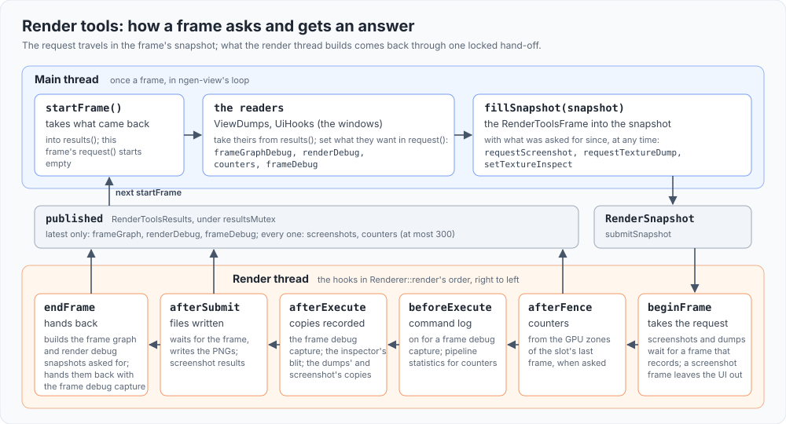

# Render tools

The `rendertools` library: the renderer's instrumentation, apart from its core (`src/renderer/README.md`). It joins the renderer's frame as a
render extension (`RenderTools`, "Extensions" in the renderer's README), and nothing of it runs unless asked for. It includes no ImGui and no
tool, so a program without the UI keeps every record and dump it serves.

## What is here

| What | Files | Serves |
|---|---|---|
| The extension | `rendertools.h/.cpp` (`RenderTools`, `RenderToolsFrame`, `RenderToolsResults`) | the requests below, each frame |
| Render debug snapshot | `renderdebug.h`, `renderdebugjson.h/.cpp` | device limits, swapchain and pacing, the scene's tables, passes with their stats and GPU times, pool textures, the draw log, allocations and heaps: the `render` and `memory` records, the Render Debug and Memory windows |
| Frame graph debug snapshot and previews | `framegraphpreviews.h/.cpp` | the Frame Graph and Capture windows: every pass and resource, and a thumbnail of each texture after each pass |
| Frame debugger | `framedebug.h/.cpp` | one frame recorded with the command log: per pass its barriers (with the backend's stages, accesses and layouts), commands and descriptor sets: `dump-frame`, `introspect.frame`, the Frame Debugger window |
| GPU counters | `gpucounters.h/.cpp` | every GPU zone of a frame and, while on, each pass's pipeline statistics: the `counters` record and the Counters window |
| Texture inspector and dumps | `rendertools.cpp` | one level of one texture blitted into a preview, or written as PNG (`inspect`, `dump-texture`); an HDR texture (the sky) previews as half float, and its PNG is its radiance clamped to 1 and encoded as sRGB |
| Screenshots | `screenshot.h/.cpp` | the presented image as PNG (`screenshot`, `--screenshot`, F12), the UI left out unless `--show-ui` |
| Tracy frame images | `frameimage.h/.cpp` (`FrameImages`) | while a Tracy server is connected and `profile.tracy.frameImages` is on: the presented image, UI included, blitted to 320 pixels wide and read back in its own frame, handed to Tracy at that slot's next fence, under the main-thread frame that asked (`src/profile/README.md`, "Tracy") |
| Capture files | `capturefiles.h/.cpp`, `gpuscenecapture.h/.cpp` | a capture written as PNG and JSON (`capture`, the Capture window's save); the GPU scene's tables joined per instance (`dump-gpuscene`, the GPU Scene window) |

## How a frame asks

- **On the main thread**, once a frame: `startFrame` takes what came back since the last frame into `results()` and starts the frame's
  `request()`; the readers (ngen-view's dumps, the UI's windows) set what they want there (the frame graph and render debug snapshots, counters, a
  frame debug capture) and take theirs from `results()`; `fillSnapshot` puts the request in the frame's `RenderSnapshot`, with the texture
  inspector's selection and the screenshots and dumps asked for since (`requestScreenshot`, `requestTextureDump`, `setTextureInspect`, any time),
  `profile.tracy.frameImages` and the main thread's frame number (`profile::frameMarks`) for the frame image.
- **On the render thread**, at the renderer's hooks: `beginFrame` takes the request (screenshots and dumps wait for a frame that records, and a
  screenshot frame tells the UI to stay out); `afterFence` makes counters from the slot's GPU zones and hands them back (every frame's, the last
  300 kept); `beforeExecute` turns the command log on for a frame debug capture, and `afterExecute` builds that capture and records the
  inspector's blit, the dumps' and the screenshot's copies, and while Tracy is connected the frame image's blit and readback (each slot its
  own target and buffer, made on first use; `afterFence` hands the slot's last image to Tracy without waiting); `afterSubmit` waits for the frame, writes the files and hands back each screenshot's
  result; `endFrame` builds the frame graph and render debug snapshots asked for and hands them back with the frame debug capture, latest-only.
  What is handed back waits under a lock until the next `startFrame` takes it.

## Rules

- **Layering**: links `renderer`, `trace` and `profile`; `viewcommands`, `ui` and the program link it. Nothing in the renderer includes a header
  from here.
- **Free when off**: a snapshot is built, a command logged or a counter read only in a frame that asked for it.
- **Previews**: textures for a UI go through `PreviewTextures`; without one, none are made, and the dumps' pixels are still there.
