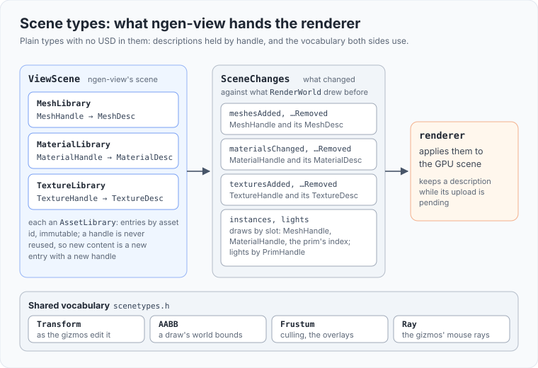

# Scene types

The plain types the renderer and ngen-view share for what is drawn. No USD, no runtime scene: the runtime scene is the World
(`src/world/README.md`), which ngen-view flattens into these (`src/view/README.md`). The USD scene that used to live here is in
`src/editor/` (`src/editor/README.md`).

| Files | What |
|---|---|
| `assetlibrary.h` | `AssetLibrary`: entries kept across rebuilds by key (an asset id), immutable, with handles never reused; new content is a new entry |
| `mesh.h` | `MeshDesc` (vertices, 32-bit indices, submesh ranges, `doubleSided`) and `MeshLibrary`, one per mesh asset, keyed by `MeshHandle` |
| `material.h` | `MaterialDesc` (base colour factor and texture, the cutout opacity: threshold, constant, channel, raw flag, its texture or the base colour's), `TextureDesc` (its format: RGBA8 sRGB with every level, or a dome's sky as RGB9E5 with one level and its irradiance), `MaterialLibrary` and `TextureLibrary` |
| `scenetypes.h` | `Transform` (position, rotation, scale, as the gizmos edit it), `AABB`, `Frustum`, `Ray`, and `LightDesc` (only the unbuilt editor uses it) |
| `scenehandles.h` | the 1-based handles: `MeshHandle`, `MaterialHandle`, `TextureHandle`, `PrimHandle` (a light's or the sky's prim; a draw holds its prim as a plain index), `LayerHandle` (only the editor's) |
