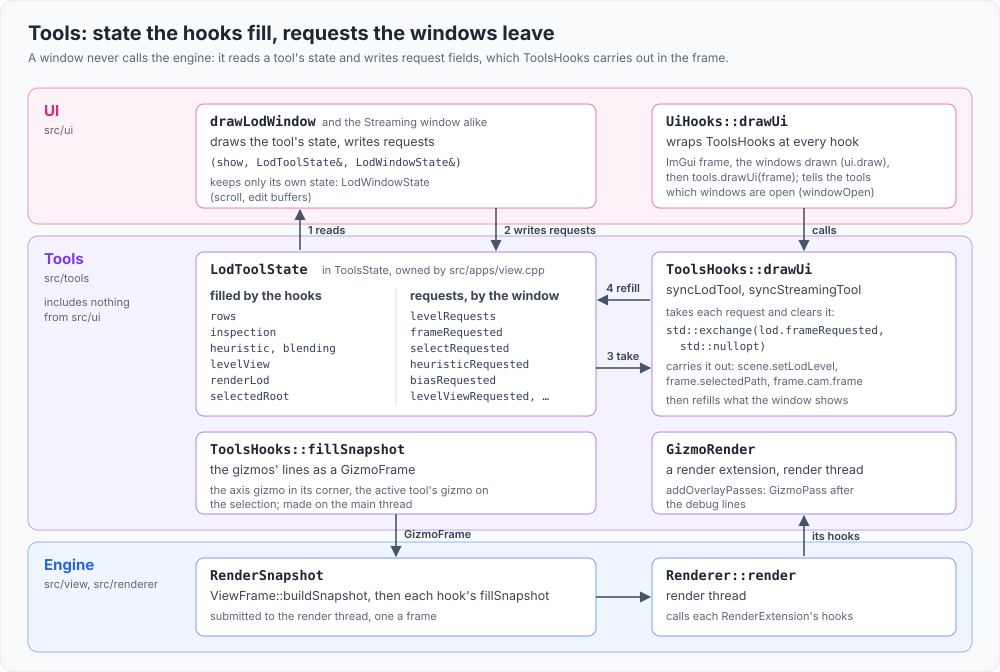

# Tools

The `tools` library: what the engine's tools know and do, apart from the UI that shows them. A tool builds its data from the engine (the
view's scene, the renderer's readbacks), draws its viewport layers with `DebugDraw`, and keeps its state in a plain struct the application
owns. The UI's windows (`src/ui`) draw that state and write requests into it; they keep only their own state (scroll, edit buffers, a map's
pan and zoom). Nothing here includes the UI, so the UI can be left out and the tools still build.

## What is here

| Tool | Files | State | Its viewport layers |
|---|---|---|---|
| LOD | `lodtool.*` | `LodToolState`: the rows (every streaming root and render-LOD group), the inspection, the list's filters, the selection, the render-LOD counts, the window's requests | labels, the heuristic gizmo, the pop flash, the LOD Level view's colours (`tools.lod.*`) |
| Streaming | `streamingtool.*` | `StreamingToolState`: the rows, totals, inspection, filters, selection, the strip chart's history, the cameras for the map, the flight, the requests | bounds, load and unload rings, labels (`tools.streaming.*`) |
| Debug camera | `debugcamera.*` | `DebugCameraState`: its pose and the main camera's trail | the main camera's frustum, body and trail; its switches are `tools.debugcamera.*` |
| Overlays | `overlays.*` | none: their switches are configuration values (`tools.overlay.*`) | the grid, the origin, every instance's bounds, the bounds by cull result, the frozen frustum, the cascades' light frusta, the lights' directions, the selection's bounds |
| Gizmos | `gizmo.h`, `axis3dgizmo.*`, `translategizmo.*`, `rotategizmo.*`, `scalegizmo.*`, `gizmopass.*`, `gizmorender.*` | the active tool (`ToolsState::activeTool`, the menu's) | the transform gizmos on the selection and their drags; the axis gizmo in the view's corner, whose click turns the camera rendered from. All on the main thread; the render thread only draws their lines (`GizmoRender`, a render extension: `GizmoPass` after the debug lines) |

`tools.h` holds the three as `ToolsState`, which `src/apps/view.cpp` owns and binds into `ViewUI` (`bindTools`).

**In the frame.** `ToolsHooks` (`toolshooks.*`) is the tools' part of ngen-view's frame, at the view's hook points (`src/view/README.md`, "The
frame"): after the scene update it builds the LOD and Streaming rows, once per scene snapshot while the tool is shown (its window open, a layer
on, or the streaming view); after the commands the debug camera, placed when turned on, takes over the cameras it drives; it takes the C key
and the gizmos' clicks and drags before the view's controls; after culling it extends the trail and gives the LOD rows the GPU's state; it
draws the overlays and the tools' layers; in the UI step it carries out what the tools' windows asked for and refreshes what they show (the
render-LOD counts, the tuning, the selected root, the inspectors four times a second, the chart, the flight); and it adds the tools' layers to
the snapshot, and the gizmos' lines as `GizmoRender`'s data (`GizmoFrame`, src/renderer/README.md, "Extensions"). The UI's hooks wrap it (`src/ui/uihooks.*`) and tell it which windows are open (`windowOpen`).
`toolcommands.*` registers the tools' methods, verbs and records over it: `view.camera.debug`, `view.lod.inspect`, `view.streaming.inspect`;
`debug-camera`, `lod-show`, `streaming-show`; `debugcamera`, `lodtool`, `streamingtool`. It also gives the engine's camera commands the
debug camera (`ViewContext::debugCamera`), so `camera: "debug"` reaches it, and `lodCamera` (`debugcamera.h`) says which camera LOD and
streaming are decided from. How each tool works is in `src/view/README.md` ("The LOD tool", "The Streaming tool", "The debug camera").

## Rules

- **Layering**: the library links `view`, `viewcommands`, `renderer` and `config`; `ui` links it. Its render-thread part is a render extension
  (`GizmoRender`), so the renderer names none of it. Nothing here includes a `src/ui` header, and
  nothing in `src/view` or the renderer includes a header from here. SDL's event types are the one window-layer header here: the hooks take the
  window's events as the view's loop polls them.
- **State**: a tool's state is data the tools' hooks fill and the windows read; requests (a level set, a root framed, radii tuned) are
  fields the window sets and the hooks apply and clear in the frame, never calls into the engine from the window.
- **Hooks**: what a tool does each frame goes in `ToolsHooks` at its point in the frame, never in `src/apps/view.cpp`'s loop.
- **Settings**: a tool's switches and layers are configuration values (`src/config/README.md`), named `tools.<tool>.*`, declared in its
  `.cpp` and named in its header; windows edit them by name.
